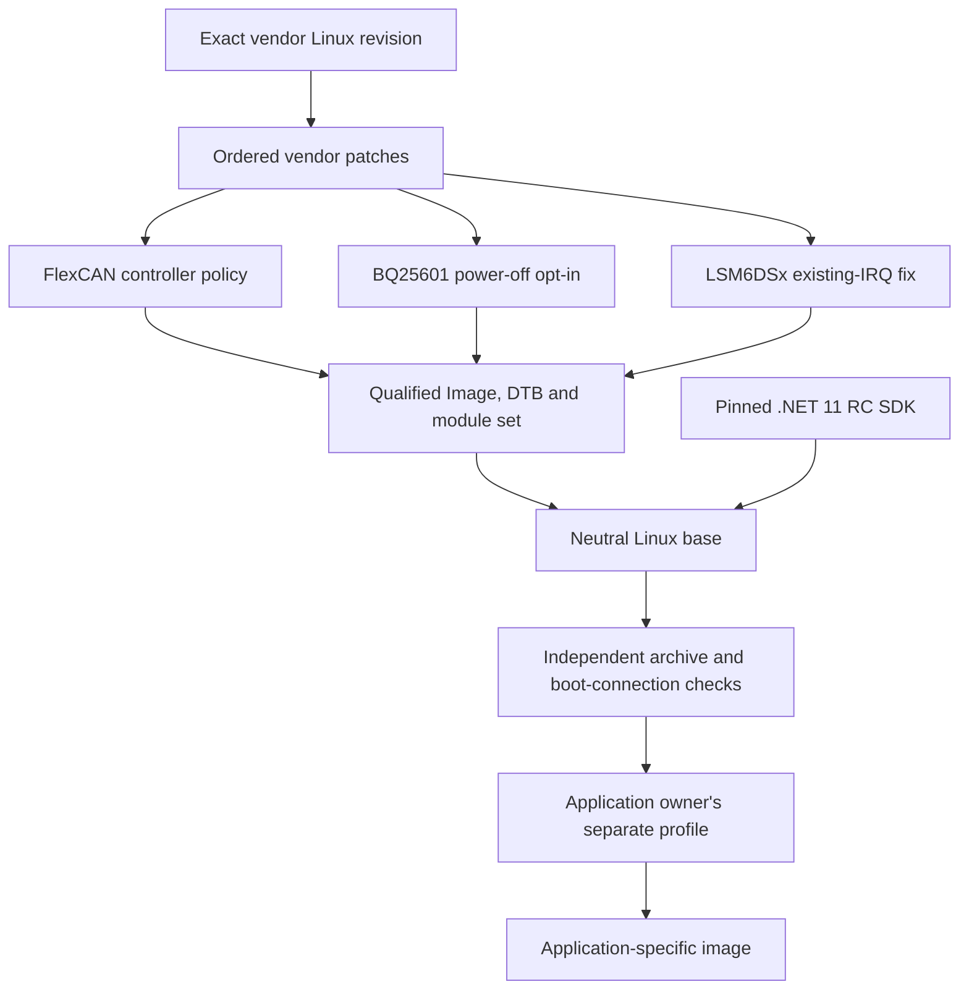
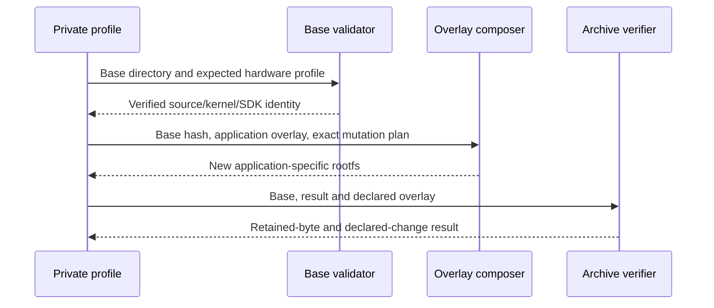

# iWave Linux extensions

Linux kernel extensions, host tests and neutral image tooling for iWave hardware.
The first hardware profile targets the **Telematics Connect Hub G62H with NXP
i.MX91 and TCH REL3.3**. The project is maintained by Marcin Borecki and is
independent of iWave and NXP.

The code addresses three concrete integration problems: controller-level CAN
filtering with an observable ownership contract, an explicit BQ25601 power-off
request, and an IMU interrupt conflict when handing the sensor from the vendor
driver to the upstream driver. A neutral image combines those changes with the
selected .NET 11 release candidate. Application software and per-installation
settings belong in a separate profile maintained by the application owner.

**Firmware redistribution is not yet cleared.** Source and tests are available
here, but generated firmware stays local. The exact sources for five retained
external modules and the redistribution terms of vendor libraries/firmware remain
unresolved. A successful image check is a technical result, not a license grant
for those components. No preconfigured device login or cellular subscription is
included in the neutral image.

## What is supported

| Boundary | Current profile |
|---|---|
| Hardware family | iWave Telematics Connect Hub G62H, i.MX91 |
| Vendor release | TCH REL3.3; its numbering is specific to this BSP family |
| Kernel source | linux-imx9-iwave, revision `02cf250c2e6bd375c11dae324ea145a39015d41b`, then all 15 vendor patches in their recorded order |
| Kernel/module candidate | `6.12.34-omam-rel33-policy1`; 807 native modules, five preserved stock modules and two matching upstream IMU modules |
| Device Tree | `imx91-iwg62h-prgtt.dtb` |
| SDK | .NET `11.0.100-rc.3.26522.148`, Linux ARM64 |
| Runtime | Microsoft.NETCore.App and Microsoft.AspNetCore.App `11.0.0-rc.3.26522.148` |
| Latest-RC check | Official Microsoft channel metadata checked on 2026-11-07; RC3 is the latest published .NET 11 RC |
| Evidence boundary | Native behavior tests, source/hash checks, static module ABI and archive-content checks; fresh physical boot, CAN traffic and power/wake qualification are separate |

Matching CPU architecture alone is insufficient. Different carrier revisions,
modems, interrupt controllers, chargers and boot layouts can require different
Device Trees, drivers and policies. An i.MX93 configuration in a vendor source
layer does not make this TCH image a supported image for every iWave product.

## How the pieces fit together



The neutral base is an input to downstream image creation. Its kernel, modules
and SDK have identities that downstream tooling must preserve. A downstream
profile may add a signed application, service units, access policy, cellular
settings and device provisioning. That profile must not modify this source tree
or put its settings back into the public base.

## Repository layout

| Directory | Responsibility |
|---|---|
| `components/flexcan-controller-policy/` | Kernel integration patch, controller implementation, pure policy logic, UAPI and exact source/result manifest |
| `components/bq25601-poweroff/` | Charger patch, source identity and native register-model regression harness |
| `components/st-lsm6dsx-existing-irq/` | The narrow IRQ workaround and its rationale |
| `profiles/tch-g62h-imx91-rel3.3/` | Exact SDK/kernel/image policy, vendor patch order and first supported hardware profile |
| `tools/kernel/` | Apply/check, native build, Image export parser, ELF/module ABI qualification and bounded process supervision |
| `tools/image/` | Streaming rootfs composition, SDK staging, neutralisation, independent content checks and additive overlays |
| `tests/native/` | C policy and RX_BUSY coverage plus patch/ELF checks |
| `tests/python/` | Public tooling, image, identity and negative-path checks |
| `docs/` | Extended hardware, design and licensing explanations |
| `.local/` | Ignored acquired source/SDK/vendor/toolchain inputs; never a public Git payload |
| `artifacts/` | Ignored generated images and local acceptance; never added to Git |

A source checkout does not contain the vendor rootfs, a compiler toolchain, an SDK
payload or ready-to-flash firmware. Obtain those inputs lawfully and verify them
against the selected profile. A vendor source URL that requires a login is not a
public corresponding-source delivery mechanism.

## What REL3.3 changes mean

REL3.3 identifies this TCH BSP delivery, not a platform-wide iWave firmware line.
The last vendor patch changes the printed REL3.2 banner to REL3.3. It does not add
.NET or replace the CAN, charger and IMU implementations by itself. The profile
retains all 15 earlier vendor patches in order: board/Device Tree and configuration,
TCH carrier support, vendor IMU, ADC calibration, BLE wake/BR/flow-control GPIO,
obsolete Device Tree removal, revision-specific GPIO settings, charger current and
shipment initialization, Quectel serial support, and BSP identification updates.
The project extensions below are applied on that exact vendor baseline. The SDK
is a separately pinned input. Older numbers in vendor patch filenames remain valid
history and are not alternative supported image selections.

## Why the changes exist

### FlexCAN controller policy

Socket filters limit what a socket receives, but they do not by themselves give
an application a controller-level filtering and ownership protocol. The extension
adds a bounded Generic Netlink interface named `omam_flexcan`. It reports
capabilities and controller state and separates validation, ownership and policy
application. The implementation stays inside the FlexCAN driver and does not open
an independent CAN data socket.

The policy compiler is shared by the driver and its native test harness. It checks
entry limits and mask semantics before a policy reaches hardware. The qualified
implementation depends on specific FlexCAN IP features, including mailbox receive
mode and the EACEN/RRS behavior used by this controller. Mailbox capacity, the
reserved transmit mailbox and the controller erratum are explicit constraints.
Unknown or incompatible controller variants must not inherit a positive capability
claim merely because their names contain FlexCAN.

The interface name and command numbers are stable ABI. The historical `omam_`
identifier is retained so that existing clients and recorded policies keep the
same meaning. It does not install or require an OMAM application.

### BQ25601 controlled power-off

An ordinary Linux shutdown and a charger shipment-mode transition are different
operations. The patch provides an explicit, RAM-only opt-in that the shutdown
path can consume. It does not unconditionally put every system into shipment
mode, persist a request across boots or decide when an application should sleep.
The board's actual charger part, supply wiring and wake path determine whether
the requested transition is appropriate.

The native harness drives the relevant driver behavior against a register model,
including failure/refusal boundaries. Register-model success does not measure
battery current, confirm a physical rail transition or prove a wake source. Keep
those claims tied to instrumented hardware observations.

### Upstream IMU ownership and an existing interrupt

The vendor IMU driver binds the sensor during boot. A later handoff to upstream
`st_lsm6dsx` can encounter an interrupt mapping already created by that driver.
Recreating it with conflicting trigger settings produced an IRQ type mismatch.
On the affected source, the upstream driver then lacked a usable interrupt for
the intended buffered-data path.

The workaround reuses an existing mapping only when the I2C client has no usable
IRQ and the node/parent mapping can be resolved under its documented assumptions.
It does not create a new mapping or reprogram its trigger type. It assumes a
specific two-cell interrupt representation, with the hardware number in its first
cell. That condition must be reviewed for a different board or interrupt domain.
The upstream driver pair is compiled against the exact selected kernel and symbol
versions. A matching filename or nominal kernel version is not ABI proof.

## What a neutral image contains

The image starts from the exact stock REL3.3 rootfs and boot inputs. It replaces
Image/DTB/modules with the qualified set and adds the pinned ARM64 SDK. It retains
required vendor runtime pieces, including the factory battery monitor and its
library, while recording their unresolved redistribution/source status.

The profile deliberately removes vendor demonstration home payloads, stored
network connections and PPP provisioning. It empties machine identity, removes
SSH host keys and supplied authorized-key material, and locks stock password
accounts. First boot can generate a machine identity and SSH host keys through
the existing systemd/OpenSSH path. There is no shared public image password and
no preselected SIM/APN. Reachability and login must be supplied by a separate
installation profile under that installation owner's control.

The neutral target is headless `multi-user.target`. Weston is masked because its
stock working directory is part of the removed demonstration home tree.
`assm_conf.service` is masked because it expects cellular configuration deliberately
absent from this base. A downstream provisioning profile can install its own modem
configuration and service ordering. The factory `battery_monitor.service` remains
enabled with its stock executable and library. This preserves its software path;
physical power protection still needs testing on the actual board.

The base has no `/opt/omam`, `/etc/omam`, `/var/lib/omam`, application package,
application authority, device key or application-server configuration. A few stable
kernel ABI/module provenance identifiers contain the original project name; those
are source/interface identities, not provisioned application state.

## Build prerequisites and input placement

Use Linux with Python 3.12 or newer, `zstd` and the standard archive tools. Native
C checks need a C compiler; full kernel builds need the pinned ARM64 toolchain,
`make`, binutils, kmod and their normal build prerequisites. Python tests use pytest; the C and standard-library unittest runners also work
without pytest. Install test dependencies in your own virtual environment with
`python3 -m venv .local/test-env` and `.local/test-env/bin/python -m pip install pytest`. No .NET build, device
connection, account credential or elevated privilege is needed to compose the
public rootfs archive from already acquired inputs.

The following paths are local examples used by the CLI below. They are ignored
acquisition/build inputs, not downloadable files provided by this Git checkout:

```text
.local/vendor/tch-g62h-imx91-rel3.3/
.local/vendor-manifest.json
.local/sources/linux/
.local/toolchain/
.local/kernel-set/
.local/kernel-build.json
.local/sdk/dotnet-11.0.100-rc.3.26522.148-linux-arm64/
```

The vendor manifest binds the original delivery identity and all nine required
boot/rootfs files. A kernel qualification receipt must match the complete module
set and its exact manifest. The SDK staging report must match the SDK lock and
actual payload tree. Do not replace pins merely to accept a convenient download.
The original vendor ZIP is unnecessary after its exact extracted inputs have been
retained and verified; it is needed again if those inputs must be acquired afresh.

Inspect the kernel source before building:

```sh
python3 -B tools/kernel/apply.py --source .local/sources/linux --with-energy --check
python3 -B tools/kernel/build.py --help
python3 -B tools/kernel/qualify.py --help
```

The build and qualify commands require explicit source, baseline, toolchain, work,
output and receipt paths. They verify CPU affinity, cgroup CPU/memory limits and
an owned process lifetime. `--allowed-cpus` names the CPUs actually reserved for
that run; defaults for other bounds are shown by `--help`. Choose those CPUs on
your host, not a machine-specific example copied from another installation. Full
kernel builds are separate from applying/checking a patch or composing an image.

## Compose and verify the base

First inspect the pinned inputs and storage admission without writing an image:

```sh
python3 -B tools/image/build_base.py \
  --profile tch-g62h-imx91-rel3.3 \
  --vendor-root .local/vendor/tch-g62h-imx91-rel3.3 \
  --vendor-manifest .local/vendor-manifest.json \
  --kernel-root .local/kernel-set \
  --kernel-receipt .local/kernel-build.json \
  --sdk .local/sdk/dotnet-11.0.100-rc.3.26522.148-linux-arm64 \
  --output artifacts/my-neutral-base --scratch-root /var/tmp --dry-run
```

Create `artifacts/` first and use a new output directory. Remove `--dry-run` only
when the inputs and storage check pass. The builder streams the archive; it does
not extract the whole vendor filesystem into a second working tree. The selected
output and scratch filesystems must have the predicted headroom plus a 500 MiB
reserve. A missing input or insufficient space is a refusal, not a partial pass.

The output contains nine exact boot/rootfs files and `base-manifest.json`. The
manifest records source/kernel/SDK identities, file hashes, neutralisation and
qualification boundaries. It records physical loading and hardware readback as
not run. Run an independent archive-content check on the rootfs:

```sh
python3 -B tools/image/verify_neutral.py \
  --rootfs artifacts/my-neutral-base/Linux/rootfs.tar.zst \
  --sha256 ROOTFS_SHA256_FROM_BASE_MANIFEST \
  --profile tch-g62h-imx91-rel3.3
```

Use the full hash from the manifest in place of the placeholder. A downstream
consumer must also validate every bound boot file, the current profile, actual
SDK bytes and the module/index set. A JSON field saying PASS is not proof of the
archive contents. `validate_base()` performs those checks before private layering.

No command above flashes a device. Flash tooling, jumpers, revision-specific
wiring, power-loss behavior and boot/readback tests are distinct installation
work. Do not run an unrelated board's boot image because it has the same CPU.

## Add an application without changing the public base

An application owner keeps its profile, signing material, access policy and device
provisioning outside this repository. The profile consumes an immutable base and
its manifest, applies only its declared overlay and produces a new output. Public
kernel/module/SDK files must remain byte-identical unless a new qualified hardware
profile is deliberately selected.

The streaming overlay API is `compose_rootfs.compose_overlay()`, with the matching
`verify_composed_rootfs.verify_overlay()` check. It accepts a base rootfs and its
SHA-256, a new output, an overlay directory and a versioned delete/replace plan.
It does not inject another SDK. The verifier compares every retained entry,
including SDK and kernel/module data, with the accepted base.



Per-device secrets are inputs to that private stage, not arguments to public CI
or fields of a public example. Do not derive a neutral base from an already
provisioned device image. Start from the pinned stock inputs and the explicit
neutral policy so that removal of known configuration is complete and testable.

## Verification and maintenance

The test layers protect different contracts:

- Native C tests cover bounded policy behavior and receive-path behavior without
  a CAN transmitter or vehicle.
- Image/parser/ELF tests include malformed input, wrong base identity, changed
  source pins, incomplete module sets and resource/refusal boundaries.
- Synthetic archive tests check actual entries, symlinks, account/network state,
  retained SDK/kernel bytes, headless boot target, service masks and factory
  monitor dependencies.
- Actual archive validation hashes the composed payload and verifies the pinned
  SDK and all qualified modules/indexes. Hardware tests remain separate.

Run the Python checks from this checkout with an environment containing pytest:

```sh
PYTHONDONTWRITEBYTECODE=1 python3 -B -m pytest -p no:cacheprovider tests/python
```

The native test runners are under `tests/native/flexcan/` and the energy component.
Their `--help` and source argument parsers identify the required compiler/source
paths. Run with an owned temporary directory and a bounded process supervisor;
never leave a replay, compiler, test service or child process behind.

The profile's SDK pin was compared with official .NET 11 channel metadata. A future
newer RC is a maintenance change: verify its official hash, stage it, renew the
SDK tree/image policy and relevant tests, then build a new base. Rebuilding an
existing profile keeps its exact pin. It must not silently download a different
SDK, upgrade a kernel or weaken a compatibility check.

The 2026-11-07 local neutral composition passed independent archive checks with
814 modules and RC3 read back. A real downstream signed application overlay also
passed retained-entry comparison. Its neutral rootfs SHA-256 is
`985064489c68b676a3d0ccfeb24bd4b31510bc06dad71f2aa764f8c1bbfcb33e`.
The profile qualification record separates those observations from the reused
original full-kernel build and the unrun physical checks. No boot, CAN traffic,
current-consumption, wake or sensor-sample result is implied by archive acceptance.

## Adding another board

Start with its real board/revision, SoC, charger, IMU, interrupt wiring, controller
capabilities and vendor release. Add a distinct profile with exact sources, patch
order, Device Tree/config and qualification. Reuse a component only when its actual
hardware assumptions hold. Report native tests, static ABI, image checks, physical
boot, CAN, motion and power/wake measurements separately. Unknown or missing
measurements remain unknown.

Another manufacturer's implementation can live in a separate repository using the
same profile/source-release conventions. A shared abstraction or common repository
should follow a real second consumer; this project does not add an empty framework
for hardware it has never tested.

## Obtain the actual kernel-core source

The source-only release asset is
[kernel-core-6.12.34-tch-rel33.tar.zst](https://github.com/marcinborecki/OMAM_iwave-linux-extensions/releases/download/v0.1.0-source-only/kernel-core-6.12.34-tch-rel33.tar.zst).
Its release includes a SHA-256 sidecar. The archive contains the actual modified
Linux tree, added vendor/FlexCAN sources, the qualified configuration, licenses,
portable recipes and a per-file manifest. It excludes Git administration, build
outputs and private acquisition data. This provides the preferred kernel-core
sources without a vendor login; it is explicitly incomplete for the five retained
factory external modules and supplies no proprietary firmware/library binaries.

To create the same type of source delivery from your own qualified inputs:

```sh
python3 -B tools/source/package.py \
  --source .local/sources/linux --kernel-set .local/kernel-set \
  --output /path/to/new/kernel-core.tar.zst --max-output-bytes 1073741824
```

The output path must be absent. Admission covers the declared output bound plus
500 MiB; compression has a file-size limit and deadline. Original working-tree
revision, diff and added-file hashes must match the qualified kernel manifest.
Do not use `git archive HEAD` alone: it would omit the actual vendor modifications
and added sources. The compiler was GCC 14.3.0, Ubuntu package 14.3.0-14ubuntu1,
on native ARM64; the profile records its compiler and package hashes. A different
compiler is a new build input, and byte-identical rebuilds have not been established.

## Licensing and source delivery

Original project tooling and kernel changes are GPL-2.0-only unless a file says
otherwise. Preserve original notices and per-file licenses. The UAPI retains the
Linux syscall exception; normal userspace use does not by itself relicense an
application under the kernel's GPL. The source grant does not cover unrelated
vendor libraries, firmware or local acquisition material.

A patches-only repository is useful for development but is not automatically
complete corresponding source for every binary image. The current kernel has five
preserved external modules. Candidate source revisions have been traced through
the vendor BSP manifest and package metadata; their correspondence to the actual
factory binaries still needs verification.
Vendor proprietary binary redistribution terms also need confirmation. Generated
images therefore record `redistribution_status: BLOCKED` and are not published as
firmware releases.

The preferred release process pairs a distributed kernel/module set with an exact
source package, build/config/Device Tree inputs, necessary installation scripts,
original licenses and a manifest linking source and binary identities. Vendor Git
administration, credentials, private application configuration and whole unrelated
BSP/rootfs bundles are not part of that source package. Do not make a private
application repository public as a way to publish these extensions.
