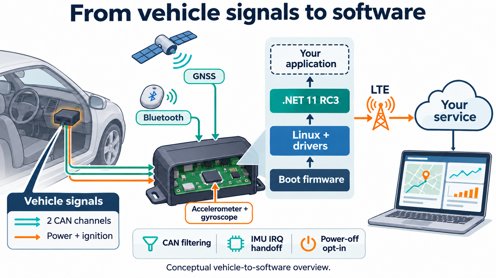
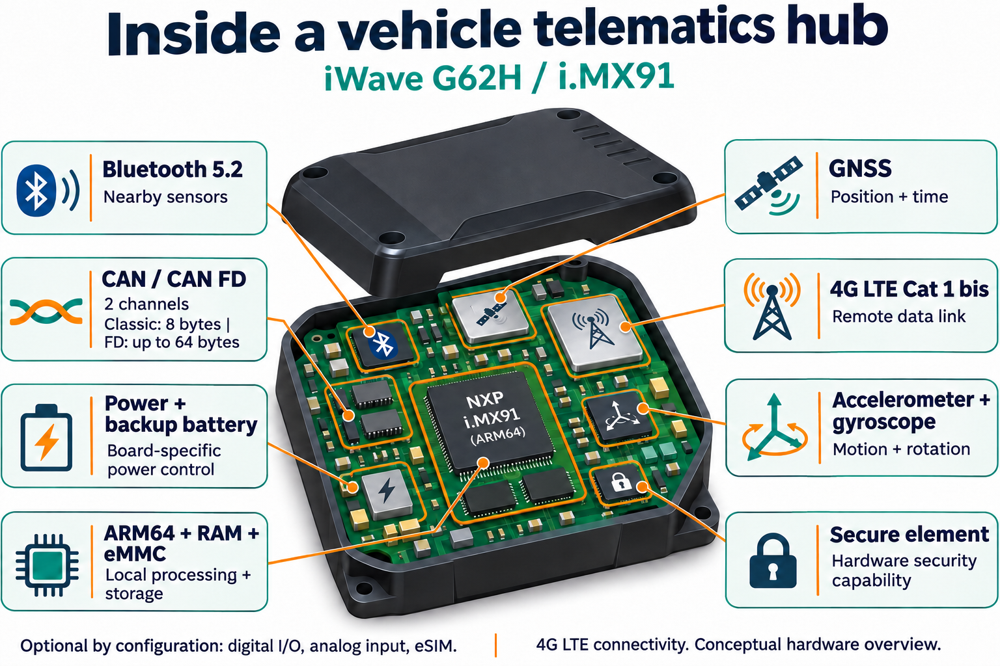
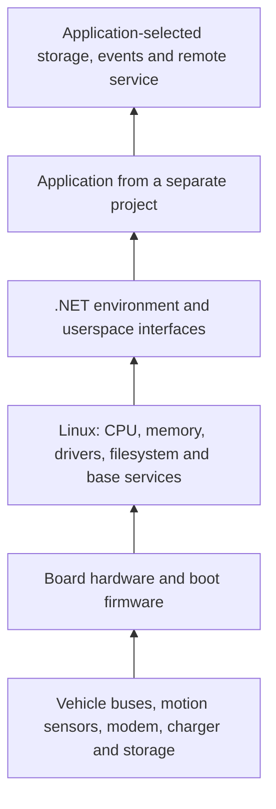
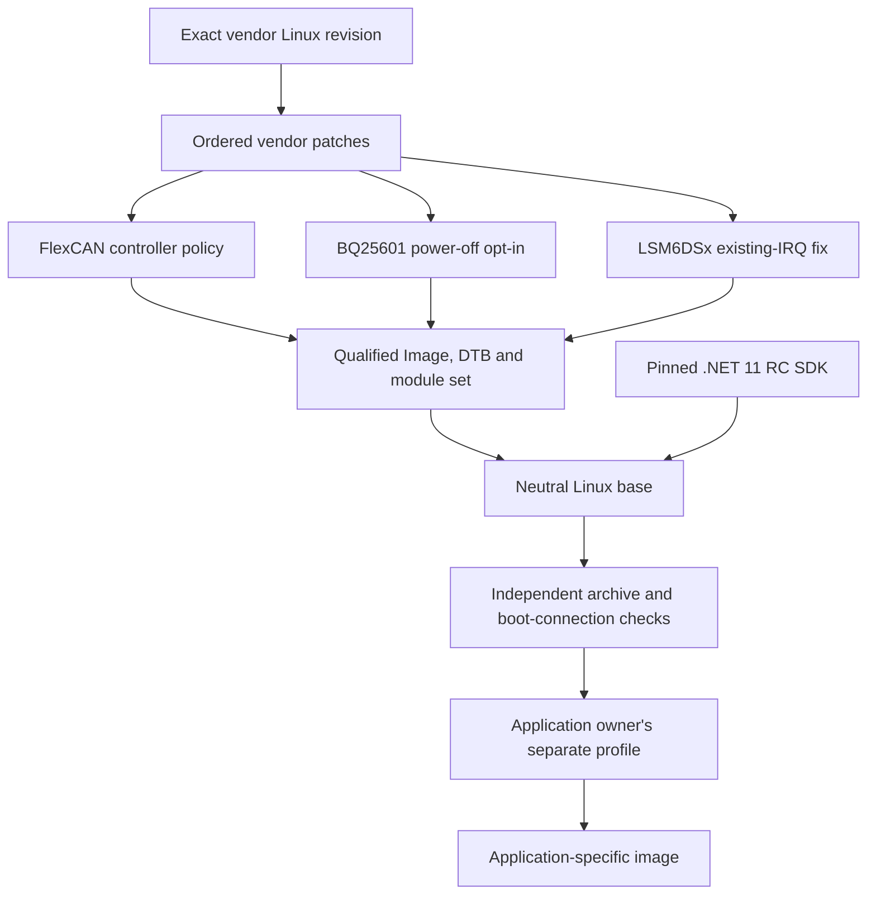
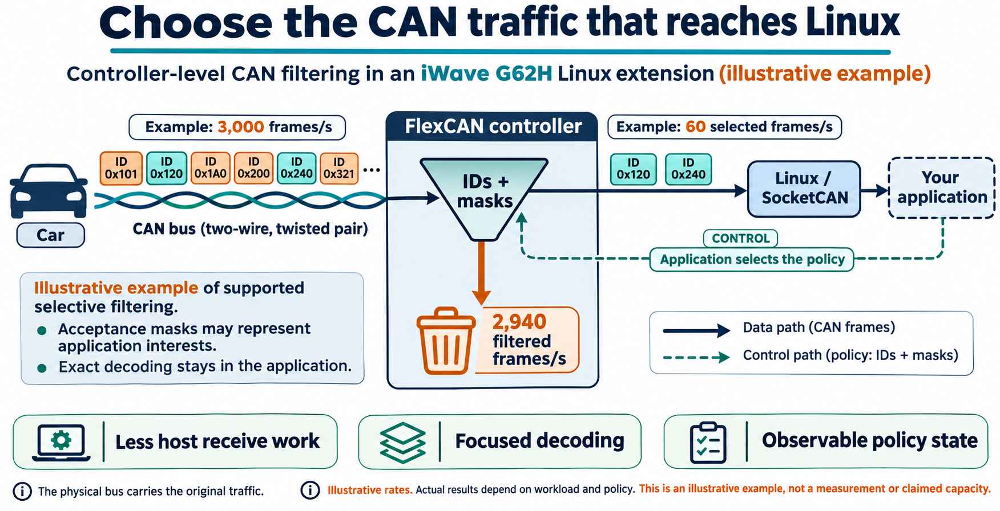
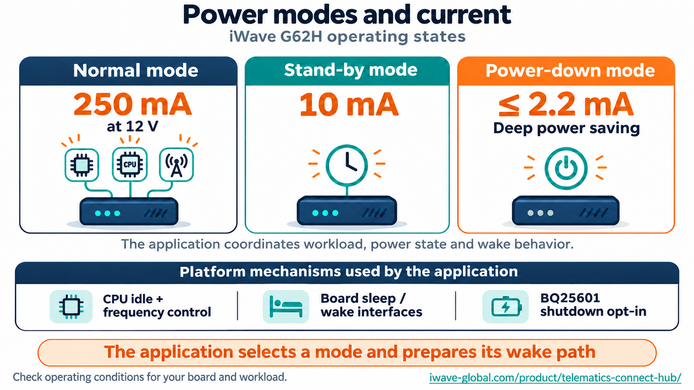
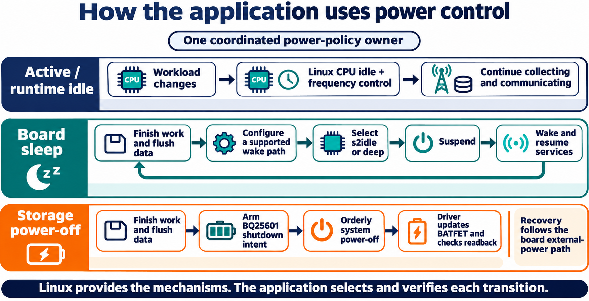
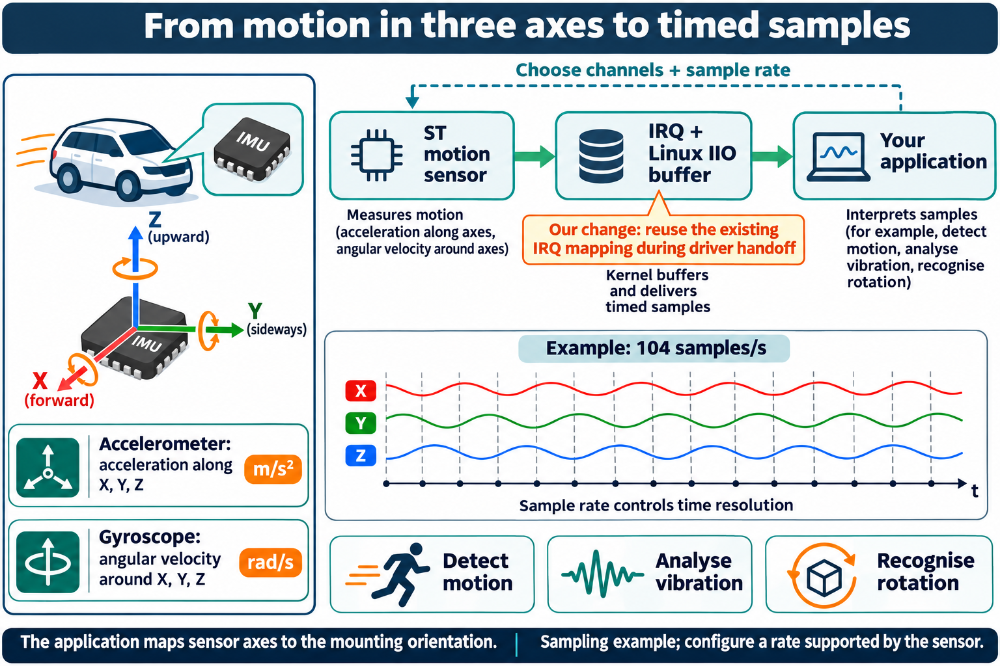
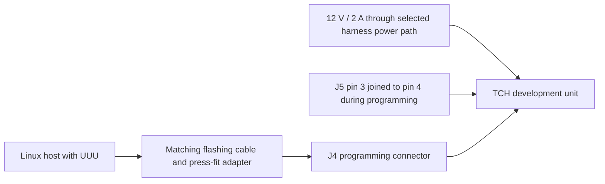
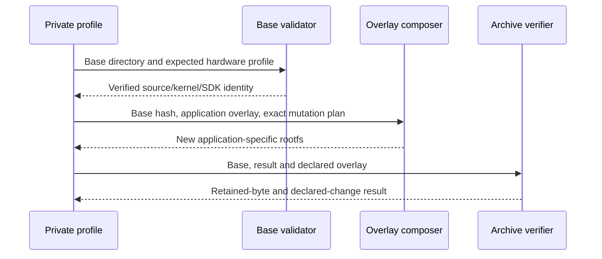

# iWave Linux extensions

**This repository maintains the operating-system layer for an iWave device:**
Linux, hardware drivers, base services and a pinned .NET environment. It gives a
separate application a dependable way to use the processor, memory, CAN buses,
motion sensors, network interfaces and power-control mechanisms.

The application decides which vehicle data matters, how to interpret it, when to
record or transmit it and which energy policy to apply. That application is built
and provisioned in its own project. This repository supplies the platform beneath
it and the recipes to compose a neutral system image.

The first profile targets the **iWave Telematics Connect Hub G62H development unit,
NXP i.MX91, TCH REL3.3**. Maintained by Marcin Borecki, this is an independent
project built around the supplied BSP and specific Linux extensions.



*Conceptual vehicle-to-software overview. The dashed application block represents
the downstream project. The device drawing explains roles and connections; actual
connector placement follows the selected hardware revision.*

## What iWave and the Connect Hub are

iWave designs embedded computing hardware and its Board Support Packages (BSPs).
A BSP brings a particular board to life: boot firmware, Linux configuration,
Device Trees, peripheral drivers and supporting software. Its catalogue includes
processor modules, development boards and complete telematics devices.

The Connect Hub is a small onboard computer for collecting and processing data
in a vehicle or machine. A deployment can put it in a protected dashboard space,
an equipment compartment or a secured enclosure position chosen by the installer.
The installation plan covers mounting, harness strain relief, power, service access
and reception for the internal antennas. The development kit exposes additional
service connections for programming and debugging.

Examples of applications built above that hardware include fleet telemetry,
equipment monitoring, motion-event recording and a gateway for nearby Bluetooth
sensors. The application supplies the relevant decoders, event rules, storage
policy and service connection. A CAN identifier becomes a meaningful value such
as speed or battery charge only after a decoder for that vehicle interprets it.

## Hardware that makes those applications possible



*Functional hardware overview. Feature populations and harness options follow the
ordered part number and PCB revision. CAN payload figures in the illustration are
maximum data lengths for the respective frame format.*

| Capability | What it makes possible | What the application contributes |
|---|---|---|
| Two CAN-FD channels | Receive vehicle/ECU messages on two independent physical buses, using the configured Classic CAN or CAN FD mode. | Select IDs, decode payloads, combine signals and apply the relevant vehicle/protocol rules. |
| Bluetooth 5.2 | Communicate with nearby compatible devices and receive sensor advertisements. | Choose supported sensor formats, interpret their measurements and manage scan/connection policy. |
| 4G LTE Cat 1 bis | Carry telemetry and management traffic between the device and a remote service. | Supply SIM/carrier configuration, credentials, protocol, retry and upload policy. |
| GNSS | Obtain position and time from satellite reception. | Validate fixes, build tracks and correlate observations with other signals. |
| Accelerometer and gyroscope | Observe acceleration along three axes and angular velocity around three axes. | Configure sampling, mounting orientation, calibration and motion/event interpretation. |
| ARM64 processor, RAM and eMMC | Run Linux, process data locally and retain state through the filesystem. | Set workload, buffering, durable storage and lifecycle requirements. |
| Charger and backup-battery path | Monitor supply conditions and perform supported board power transitions. | Coordinate workload, power ownership and a tested recovery/wake policy. |
| Hardware secure element | Provide hardware-backed security capabilities for an integrated design. | Choose and provision a supported security integration. |
| Ignition and ordered I/O options | Observe the ignition input and, for populated options, digital/analog signals. | Bind wiring and signal meaning to the actual installed equipment. |

The current public G62H specification identifies LTE Cat 1 bis, Bluetooth 5.2,
two CAN-FD ports, GNSS, motion sensors and an i.MX91 platform. It marks digital
input/output, analog input and eSIM as configuration-dependent options. Hardware
and SKU details come from the [iWave G62H product specification](https://iwave-global.com/product/telematics-connect-hub/);
the [NXP i.MX91 description](https://www.nxp.com/products/i.MX91) identifies the
processor family. The profile binds its actual Device Tree, kernel and module set.

### CAN and CAN FD in everyday terms

A CAN bus is a shared two-wire message network. Each frame carries an identifier
and a short payload. Two physical channels let the hub connect to two separately
configured networks; the application keeps their signals distinct.

| Format | Maximum data payload per frame | Practical meaning |
|---|---:|---|
| Classic CAN | 8 bytes | Frequent compact messages, often carrying several encoded vehicle signals. |
| CAN FD | 64 bytes | Larger messages and an optional faster data phase when the bus and devices support that configuration. |

The operating system exposes the controller through SocketCAN. Bit timing,
transceivers, wiring and termination are properties of the actual bus setup;
application decoding gives frame bytes their meaning. The controller policy
extension described below acts on acceptance before the host processes every
message. See the [Linux SocketCAN documentation](https://docs.kernel.org/networking/can.html)
for the frame and socket interfaces.

### Growing beyond this first hardware profile

The same manufacturer offers larger telematics platforms with additional network
interfaces and processing capacity. For example, [Telematics EdgePrime](https://iwave-global.com/product/telematics-edgeprime/)
advertises an i.MX93 platform, four CAN-FD ports and a cellular upgrade path toward
5G. Such a device gets its own hardware profile, Device Tree and qualification.
Component reuse follows actual controller, charger and interrupt assumptions.

## Where this repository sits



| Layer | Responsibility in the running device |
|---|---|
| Board and boot firmware | Initialize the platform and load its operating system. |
| Linux kernel and Device Tree | Schedule CPU work, manage memory, bind the real board peripherals and expose their interfaces. |
| Drivers and base services | Deliver CAN and sensor data, maintain device state and carry out requested low-level operations. |
| .NET runtime and SDK | Provide the selected managed-code execution/development environment. |
| Downstream application | Interpret measurements, select capture/filter/sample policy, manage its data and coordinate operational decisions. |

The system already runs useful platform work at boot, including Linux resource
management and the retained factory battery monitor. An application can introduce
its own coordinated management policy and take ownership through the appropriate
interfaces. This distinction matters for all three extensions: a mechanism in a
driver becomes an operational feature when its consumer configures and observes it.

## What the composed image is made from

| Image part | Origin and role | How this project treats it |
|---|---|---|
| Bootloader and temporary flashing/recovery environment | Supplied board boot chain and UUU inputs. | Bound to the selected vendor delivery and kept with the matching board profile. |
| Linux Image and Device Tree | Pinned vendor source plus fifteen ordered vendor patches. | Integrates the FlexCAN and charger changes with the actual board configuration. |
| Kernel modules and dependency indexes | 807 native, five retained factory external modules and two external upstream IMU modules. | Qualified together against the same kernel; built-in drivers also reside inside Image. |
| Root filesystem and base services | Stock Yocto userspace, utilities, modem/sensor support and factory battery protection. | Applies a declared neutralisation overlay and preserves required service dependencies. |
| .NET 11 RC3 | Full Linux ARM64 SDK and shared runtimes. | Pinned by official download and actual staged-tree hashes. |
| Installation-specific application and configuration | Supplied by a separate downstream project. | Added to a new image by its private profile, preserving the accepted kernel/SDK identity. |

The project changes specific platform boundaries that blocked the intended use:
controller-level receive filtering, a controlled charger shutdown request and an
IRQ mapping needed by an alternative motion-sensor driver. Each is described with
its motivation, activation path and impact below.

## What is available to download

The public repository contains the maintained extensions, tests, profiles and image
recipes. The source-only release also supplies the actual preferred modified
kernel-core tree with original notices and a per-file manifest.

Complete firmware images currently remain local. The composed image retains five
factory modules with public candidate sources whose correspondence to the shipped
binaries still needs verification. Redistribution terms for included libTelematics
and other vendor binary payloads remain to be established from the supplied material.
Those image-specific questions are separate from the GPL source release, whose
stated license provides its redistribution permissions.

## What is supported

| Boundary | Current profile |
|---|---|
| Hardware family | iWave Telematics Connect Hub G62H, i.MX91 |
| Vendor release | TCH REL3.3; its numbering is specific to this BSP family |
| Kernel source | linux-imx9-iwave, revision `02cf250c2e6bd375c11dae324ea145a39015d41b`, then all 15 vendor patches in their recorded order |
| Kernel/module candidate | `6.12.34-omam-rel33-policy1`; 807 native modules, five preserved stock modules and two matching upstream IMU modules |
| Device Tree | `imx91-iwg62h-prgtt.dtb` |
| SDK | .NET `11.0.100-rc.3.26522.148`, Linux ARM64 |
| Runtime | Microsoft.NETCore.App and Microsoft.AspNetCore.App `11.0.0-rc.3.26522.148` |
| Latest-RC check | Official Microsoft channel metadata checked on 2026-11-07; RC3 is the latest published .NET 11 RC |
| Evidence boundary | Native behavior tests, source/hash checks, static module ABI and archive-content checks; fresh physical boot, CAN traffic and power/wake qualification are separate |

Matching CPU architecture alone is insufficient. Different carrier revisions,
modems, interrupt controllers, chargers and boot layouts can require different
Device Trees, drivers and policies. An i.MX93 configuration in a vendor source
layer does not make this TCH image a supported image for every iWave product.

## How the pieces fit together



The neutral base is an input to downstream image creation. Its kernel, modules
and SDK have identities that downstream tooling must preserve. A downstream
profile may add a signed application, service units, access policy, cellular
settings and device provisioning. That profile must not modify this source tree
or put its settings back into the public base.

## Repository layout

| Directory | Responsibility |
|---|---|
| `components/flexcan-controller-policy/` | Kernel integration patch, controller implementation, pure policy logic, UAPI and exact source/result manifest |
| `components/bq25601-poweroff/` | Charger patch, source identity and native register-model regression harness |
| `components/st-lsm6dsx-existing-irq/` | The narrow IRQ workaround and its rationale |
| `profiles/tch-g62h-imx91-rel3.3/` | Exact SDK/kernel/image policy, vendor patch order and first supported hardware profile |
| `tools/kernel/` | Apply/check, native build, Image export parser, ELF/module ABI qualification and bounded process supervision |
| `tools/image/` | Streaming rootfs composition, SDK staging, neutralisation, independent content checks and additive overlays |
| `tests/native/` | C policy and RX_BUSY coverage plus patch/ELF checks |
| `tests/python/` | Public tooling, image, identity and negative-path checks |
| `docs/` | Extended hardware, design and licensing explanations |
| `.local/` | Ignored acquired source/SDK/vendor/toolchain inputs; never a public Git payload |
| `artifacts/` | Ignored generated images and local acceptance; never added to Git |

A source checkout does not contain the vendor rootfs, a compiler toolchain, an SDK
payload or ready-to-flash firmware. Obtain those inputs lawfully and verify them
against the selected profile. A vendor source URL that requires a login is not a
public corresponding-source delivery mechanism.

## What REL3.3 changes mean

REL3.3 identifies this TCH BSP delivery, not a platform-wide iWave firmware line.
The last vendor patch changes the printed REL3.2 banner to REL3.3. It does not add
.NET or replace the CAN, charger and IMU implementations by itself. The profile
retains all 15 earlier vendor patches in order: board/Device Tree and configuration,
TCH carrier support, vendor IMU, ADC calibration, BLE wake/BR/flow-control GPIO,
obsolete Device Tree removal, revision-specific GPIO settings, charger current and
shipment initialization, Quectel serial support, and BSP identification updates.
The project extensions below are applied on that exact vendor baseline. The SDK
is a separately pinned input. Older numbers in vendor patch filenames remain valid
history and are not alternative supported image selections.

## Why the changes exist

### FlexCAN controller policy



A vehicle network can generate thousands of frames per second. An application
may need only a small set of identifiers, such as those carrying the signals it
actually interprets. As an illustrative workload, a bus carrying 3,000 frames/s
might contain 60 frames/s for those interests. The figure uses those example
numbers to explain the flow; the actual rates are measured on the installation.

Selecting the relevant identifiers in the controller reduces host receive and
decoding work for other traffic. The physical bus still carries its original
messages. Masks can deliberately admit a broader set than the exact decoder needs;
the application keeps its own exact filtering and validates the resulting policy.
The impact depends on traffic, representable masks, mailbox capacity and driver
state. It is evaluated as host work and measured system behavior.


Socket filters limit what a socket receives, but they do not by themselves give
an application a controller-level filtering and ownership protocol. The extension
adds a bounded Generic Netlink interface named `omam_flexcan`. It reports
capabilities and controller state and separates validation, ownership and policy
application. The implementation stays inside the FlexCAN driver and does not open
an independent CAN data socket.

The policy compiler is shared by the driver and its native test harness. It checks
entry limits and mask semantics before a policy reaches hardware. The qualified
implementation depends on specific FlexCAN IP features, including mailbox receive
mode and the EACEN/RRS behavior used by this controller. Mailbox capacity, the
reserved transmit mailbox and the controller erratum are explicit constraints.
Unknown or incompatible controller variants must not inherit a positive capability
claim merely because their names contain FlexCAN.

The interface name and command numbers are stable ABI. The historical `omam_`
identifier is retained so that existing clients and recorded policies keep the
same meaning. It does not install or require an OMAM application.

### BQ25601 controlled power-off



The G62H product table gives these reference currents:

| Operating state | iWave table value | Conditions recorded with that value |
|---|---:|---|
| Normal | 250 mA | 12 V supply; workload and peripheral configuration are not specified. |
| Stand-by | 10 mA | Confirm voltage, active peripherals and wake configuration for the selected board. |
| Power down | ≤2.2 mA | Confirm the exact power-down sequence and its operating conditions. |

These figures describe the manufacturer's operating modes. The software path is
real: Linux supplies idle/frequency and suspend mechanisms, the vendor stack
provides board wake interfaces, and our charger patch supplies a controlled
shutdown operation. The application coordinates those mechanisms for its workload.
A current value is the result of the board reaching its selected electrical state.
Measure that result with the actual supply, modem, battery and wake configuration.

The product page also gives approximately 1.2 mA for deep power-down in its FAQ.
This guide uses the specification-table value above and retains that difference
for reconciliation with iWave's mode definitions and measurement conditions.
Source: [G62H power characteristics](https://iwave-global.com/product/telematics-connect-hub/).



| Application intent | Platform path | Operational contract |
|---|---|---|
| Keep working with less activity | CPU idle/frequency control and an application runtime-idle policy. | Linux and selected communications remain available while workload is reduced. |
| Pause and resume | Discover the supported `s2idle`/`deep` backend, configure wake, flush work, then request suspend. | The selected wake route returns the system and services to operation. |
| Prepare for storage | Finish work, arm `ship_mode_on_poweroff`, then request an orderly system power-off. | The charger performs its delayed BATFET operation at shutdown; recovery follows the board's external-power path. |

The base supplies those low-level mechanisms and keeps factory battery protection
running. A downstream application's manager takes coordinated ownership when it
introduces its own automatic policy. Qualification records current, state transition
and wake/restart for each selected mode. The existing downstream OMAM implementation
already has these software paths; this platform work reuses their mechanisms.


Linux power management has several levels. CPU idle/frequency control adapts work
while the OS is running. Board sleep suspends selected activity with a configured
wake route. An orderly shutdown finishes services and filesystem work. The charger
extension adds a separate, explicit request for delayed BATFET disable at that
shutdown boundary. A downstream manager selects the appropriate sequence; the
neutral image retains the factory monitor's existing protection role.


An ordinary Linux shutdown and a charger shipment-mode transition are different
operations. The patch provides an explicit, RAM-only opt-in that the shutdown
path can consume. It does not unconditionally put every system into shipment
mode, persist a request across boots or decide when an application should sleep.
The board's actual charger part, supply wiring and wake path determine whether
the requested transition is appropriate.

The native harness drives the relevant driver behavior against a register model,
including failure/refusal boundaries. Register-model success does not measure
battery current, confirm a physical rail transition or prove a wake source. Keep
those claims tied to instrumented hardware observations.

### Upstream IMU ownership and an existing interrupt



An IMU combines three acceleration axes with three angular-velocity axes. After
applying the IIO channel scale/offset, acceleration is expressed in m/s² and
angular velocity in rad/s. A sample stream records how those values change over
time. Orientation and event detection come from the application's interpretation
of the mounted sensor.

For the current upstream driver's LSM6DSM family, supported nominal rates are
12.5, 26, 52, 104, 208 and 416 Hz. At 104 Hz, one enabled stream nominally produces
104 XYZ vectors each second. FIFO and IIO buffering can deliver batches, so the
application observes timestamps, selected channels and actual sampling-frequency
readback. It maps the sensor axes to the mounting orientation and chooses the
rate needed for motion events, vibration analysis or another defined workload.

Our change restores an IRQ mapping needed during a particular driver handoff.
That enables the upstream driver's intended interrupt/buffered-data path while
the sensor's sampling-rate and physical measurement capabilities remain those of
the device and driver. Actual interrupt delivery and sensor data are checked on
the selected board.


The vendor IMU driver binds the sensor during boot. A later handoff to upstream
`st_lsm6dsx` can encounter an interrupt mapping already created by that driver.
Recreating it with conflicting trigger settings produced an IRQ type mismatch.
On the affected source, the upstream driver then lacked a usable interrupt for
the intended buffered-data path.

The workaround reuses an existing mapping only when the I2C client has no usable
IRQ and the node/parent mapping can be resolved under its documented assumptions.
It does not create a new mapping or reprogram its trigger type. It assumes a
specific two-cell interrupt representation, with the hardware number in its first
cell. That condition must be reviewed for a different board or interrupt domain.
The upstream driver pair is compiled against the exact selected kernel and symbol
versions. A matching filename or nominal kernel version is not ABI proof.

## What a neutral image contains

The image starts from the exact stock REL3.3 rootfs and boot inputs. It replaces
Image/DTB/modules with the qualified set and adds the pinned ARM64 SDK. It retains
required vendor runtime pieces, including the factory battery monitor and its
library, while recording their unresolved redistribution/source status.

The profile deliberately removes vendor demonstration home payloads, stored
network connections and PPP provisioning. It empties machine identity, removes
SSH host keys and supplied authorized-key material, and locks stock password
accounts. First boot can generate a machine identity and SSH host keys through
the existing systemd/OpenSSH path. There is no shared public image password and
no preselected SIM/APN. Reachability and login must be supplied by a separate
installation profile under that installation owner's control.

The neutral target is headless `multi-user.target`. Weston is masked because its
stock working directory is part of the removed demonstration home tree.
`assm_conf.service` is masked because it expects cellular configuration deliberately
absent from this base. A downstream provisioning profile can install its own modem
configuration and service ordering. The factory `battery_monitor.service` remains
enabled with its stock executable and library. This preserves its software path;
physical power protection still needs testing on the actual board.

The base has no `/opt/omam`, `/etc/omam`, `/var/lib/omam`, application package,
application authority, device key or application-server configuration. A few stable
kernel ABI/module provenance identifiers contain the original project name; those
are source/interface identities, not provisioned application state.

## Build prerequisites and input placement

Use Linux with Python 3.12 or newer, `zstd` and the standard archive tools. Native
C checks need a C compiler; full kernel builds need the pinned ARM64 toolchain,
`make`, binutils, kmod and their normal build prerequisites. Python tests use pytest; the C and standard-library unittest runners also work
without pytest. Install test dependencies in your own virtual environment with
`python3 -m venv .local/test-env` and `.local/test-env/bin/python -m pip install pytest`. No .NET build, device
connection, account credential or elevated privilege is needed to compose the
public rootfs archive from already acquired inputs.

The following paths are local examples used by the CLI below. They are ignored
acquisition/build inputs, not downloadable files provided by this Git checkout:

```text
.local/vendor/tch-g62h-imx91-rel3.3/
.local/vendor-manifest.json
.local/sources/linux/
.local/toolchain/
.local/kernel-set/
.local/kernel-build.json
.local/sdk/dotnet-11.0.100-rc.3.26522.148-linux-arm64/
```

The vendor manifest binds the original delivery identity and all nine required
boot/rootfs files. A kernel qualification receipt must match the complete module
set and its exact manifest. The SDK staging report must match the SDK lock and
actual payload tree. Do not replace pins merely to accept a convenient download.
The original vendor ZIP is unnecessary after its exact extracted inputs have been
retained and verified; it is needed again if those inputs must be acquired afresh.

Inspect the kernel source before building:

```sh
python3 -B tools/kernel/apply.py --source .local/sources/linux --with-energy --check
python3 -B tools/kernel/build.py --help
python3 -B tools/kernel/qualify.py --help
```

The build and qualify commands require explicit source, baseline, toolchain, work,
output and receipt paths. They verify CPU affinity, cgroup CPU/memory limits and
an owned process lifetime. `--allowed-cpus` names the CPUs actually reserved for
that run; defaults for other bounds are shown by `--help`. Choose those CPUs on
your host, not a machine-specific example copied from another installation. Full
kernel builds are separate from applying/checking a patch or composing an image.

## Compose and verify the base

First inspect the pinned inputs and storage admission without writing an image:

```sh
python3 -B tools/image/build_base.py \
  --profile tch-g62h-imx91-rel3.3 \
  --vendor-root .local/vendor/tch-g62h-imx91-rel3.3 \
  --vendor-manifest .local/vendor-manifest.json \
  --kernel-root .local/kernel-set \
  --kernel-receipt .local/kernel-build.json \
  --sdk .local/sdk/dotnet-11.0.100-rc.3.26522.148-linux-arm64 \
  --output artifacts/my-neutral-base --scratch-root /var/tmp --dry-run
```

Create `artifacts/` first and use a new output directory. Remove `--dry-run` only
when the inputs and storage check pass. The builder streams the archive; it does
not extract the whole vendor filesystem into a second working tree. The selected
output and scratch filesystems must have the predicted headroom plus a 500 MiB
reserve. A missing input or insufficient space is a refusal, not a partial pass.

The output contains nine exact boot/rootfs files and `base-manifest.json`. The
manifest records source/kernel/SDK identities, file hashes, neutralisation and
qualification boundaries. It records physical loading and hardware readback as
not run. Run an independent archive-content check on the rootfs:

```sh
python3 -B tools/image/verify_neutral.py \
  --rootfs artifacts/my-neutral-base/Linux/rootfs.tar.zst \
  --sha256 ROOTFS_SHA256_FROM_BASE_MANIFEST \
  --profile tch-g62h-imx91-rel3.3
```

Use the full hash from the manifest in place of the placeholder. A downstream
consumer must also validate every bound boot file, the current profile, actual
SDK bytes and the module/index set. A JSON field saying PASS is not proof of the
archive contents. `validate_base()` performs those checks before private layering.

No command above flashes a device. Flash tooling, jumpers, revision-specific
wiring, power-loss behavior and boot/readback tests are distinct installation
work. Do not run an unrelated board's boot image because it has the same CPU.

## Install on the TCH development unit

Installation uses a complete, privately prepared board image. Its application/access
profile provides the chosen login and any deployment settings. The public neutral
base has locked password accounts; prepare your own access before flashing so that
the first boot has the intended operator path. UART boot output remains useful
while bringing that profile up.

### Cables, power and the programming jumper

Use the matching iWave development-kit harness, flashing cable/press-fit adapter,
jumper and debug serial board. The hardware manual specifies a 12 V / 2 A bench
supply through the harness at P6. Select one power path: P6 harness/DC adapter or
the supplied P2/OBD power board. The chosen adapter supplies the connector polarity
and pin mapping for that kit. Connection changes follow the manual's powered-down
handling procedure, including its battery-disconnection requirement when removing
the PCB from the enclosure.



J5.3 and J5.4 are pin identities, not a drawing of header orientation. Identify the
actual marked header and matched cable on your PCB. The developer kit and the PCB
revision determine the service-access arrangement.

### Host and image directory

On an Ubuntu host, install the ordinary UUU/USB/serial tools:

```sh
sudo apt-get update
sudo apt-get install uuu usbutils minicom
```

[UUU is the NXP Universal Update Utility](https://github.com/nxp-imx/mfgtools).
Use a host binary for the computer's architecture. A VM must receive the device's
USB connection through the boot/recovery re-enumerations. The actual flash bundle
contains these relative paths:

```text
private-flash-bundle/
  iG-PRGTT-TelematicsConnectHub.uuu
  Firmware/Image_uuu
  Firmware/flash_uuu.bin
  Firmware/imx91-iwg50m-prgjj_uuu.dtb
  Firmware/initramfs.cpio.zst.u-boot
  Linux/Image
  Linux/flash.bin
  Linux/imx91-iwg62h-prgtt.dtb
  Linux/rootfs.tar.zst
```

The source-release archive supplies build inputs; the flash bundle supplies those
nine installed/recovery inputs. Validate the neutral base with `validate_base()`
before applying the private profile, then verify the resulting private bundle
against its own manifest/checksums. Preserve the accepted boot/kernel/SDK identities.

### Programming sequence

The supplied UUU recipe rewrites the bootloader, partition table and filesystems.
Preserve required device data before replacing its installed system.

1. Power down using the kit's handling procedure.
2. Fit the jumper between J5.3 and J5.4.
3. Connect J4 through the matching flashing cable/adapter to the host.
4. Apply the selected device power source.
5. Run UUU from the directory containing the recipe and its Firmware/Linux folders:

```sh
cd /absolute/path/to/private-flash-bundle
sudo uuu ./iG-PRGTT-TelematicsConnectHub.uuu
```

6. Wait for the completed result with one success and zero failures.
7. Power down, remove the programming jumper and cable as specified by the kit,
   then start the device for normal boot.

The recipe's recovery Device Tree and the installed G62H Device Tree have different
roles; keep their supplied filenames. After an interrupted attempt, first inspect
the reported failing stage, power/cable/VM USB path and input hashes, then re-enter
the documented programming sequence. This documentation describes the operation;
physical flash/boot acceptance is recorded for the actual installation.

### UART and the first boot

| Actual PCB revision in Hardware Manual REL1.7 | Debug path |
|---|---|
| R2.5, R2.7 | Internal J1 with its matching press-fit and Serial Debug Board. |
| R2.4, R2.6, R2.8, R2.9 | External harness IO connector P3 with the supplied Debug UART cable and serial board. |

The terminal uses **115200 baud, 8 data bits, no parity, one stop bit, hardware and
software flow control disabled**. Identify the host's actual serial device using
`ls /dev/serial/by-id/`; an example terminal command is:

```sh
sudo minicom -D /dev/ttyUSB0 -b 115200
```

Set the terminal parameters above in minicom's serial setup. The kit adapter
provides the required electrical interface. The reviewed manuals identify the
connector routes, while the matched harness/adapter specification supplies any
pin-level wiring needed for a custom assembly.

After login through your prepared access profile, inspect the running platform:

```sh
uname -r
/opt/dotnet/dotnet --list-sdks
/opt/dotnet/dotnet --list-runtimes
systemctl is-active battery_monitor.service
ip -details link show can0
ip -details link show can1
ls /sys/bus/iio/devices
```

These are inspection commands. They read actual state; enabling CAN transmission,
changing sensor ownership and requesting sleep are separate application-controlled
operations. Check the loaded kernel/module identity, startup logs and service state
before accepting a new hardware installation.

Source traceability: iWave Hardware User Manual R2.0/REL1.7, pages 6-7, 9, 11-17,
SHA-256 `4633153946b0cfd9ed198e6091dc62dd07c4662a2d2884e90c4eb6c09217d08a`;
Software User Manual R2.0/REL3.2, page 11, SHA-256
`32a072c37e0338c2a5e823a1fb744fd9c604226c563f4671f2089c42f21d54a2`.
These instructions and diagrams are independently written; supplied manuals remain
with their original distribution. The detailed installation text is also maintained
as `docs/installation-tch-g62h.md` in this checkout.

## Add an application without changing the public base

An application owner keeps its profile, signing material, access policy and device
provisioning outside this repository. The profile consumes an immutable base and
its manifest, applies only its declared overlay and produces a new output. Public
kernel/module/SDK files must remain byte-identical unless a new qualified hardware
profile is deliberately selected.

The streaming overlay API is `compose_rootfs.compose_overlay()`, with the matching
`verify_composed_rootfs.verify_overlay()` check. It accepts a base rootfs and its
SHA-256, a new output, an overlay directory and a versioned delete/replace plan.
It does not inject another SDK. The verifier compares every retained entry,
including SDK and kernel/module data, with the accepted base.



Per-device secrets are inputs to that private stage, not arguments to public CI
or fields of a public example. Do not derive a neutral base from an already
provisioned device image. Start from the pinned stock inputs and the explicit
neutral policy so that removal of known configuration is complete and testable.

## Verification and maintenance

The test layers protect different contracts:

- Native C tests cover bounded policy behavior and receive-path behavior without
  a CAN transmitter or vehicle.
- Image/parser/ELF tests include malformed input, wrong base identity, changed
  source pins, incomplete module sets and resource/refusal boundaries.
- Synthetic archive tests check actual entries, symlinks, account/network state,
  retained SDK/kernel bytes, headless boot target, service masks and factory
  monitor dependencies.
- Actual archive validation hashes the composed payload and verifies the pinned
  SDK and all qualified modules/indexes. Hardware tests remain separate.

Run the Python checks from this checkout with an environment containing pytest:

```sh
PYTHONDONTWRITEBYTECODE=1 python3 -B -m pytest -p no:cacheprovider tests/python
```

The native test runners are under `tests/native/flexcan/` and the energy component.
Their `--help` and source argument parsers identify the required compiler/source
paths. Run with an owned temporary directory and a bounded process supervisor;
never leave a replay, compiler, test service or child process behind.

The profile's SDK pin was compared with official .NET 11 channel metadata. A future
newer RC is a maintenance change: verify its official hash, stage it, renew the
SDK tree/image policy and relevant tests, then build a new base. Rebuilding an
existing profile keeps its exact pin. It must not silently download a different
SDK, upgrade a kernel or weaken a compatibility check.

The 2026-11-07 local neutral composition passed independent archive checks with
814 modules and RC3 read back. A real downstream signed application overlay also
passed retained-entry comparison. Its neutral rootfs SHA-256 is
`985064489c68b676a3d0ccfeb24bd4b31510bc06dad71f2aa764f8c1bbfcb33e`.
The profile qualification record separates those observations from the reused
original full-kernel build and the unrun physical checks. No boot, CAN traffic,
current-consumption, wake or sensor-sample result is implied by archive acceptance.

## Adding another board

Start with its real board/revision, SoC, charger, IMU, interrupt wiring, controller
capabilities and vendor release. Add a distinct profile with exact sources, patch
order, Device Tree/config and qualification. Reuse a component only when its actual
hardware assumptions hold. Report native tests, static ABI, image checks, physical
boot, CAN, motion and power/wake measurements separately. Unknown or missing
measurements remain unknown.

Another manufacturer's implementation can live in a separate repository using the
same profile/source-release conventions. A shared abstraction or common repository
should follow a real second consumer; this project does not add an empty framework
for hardware it has never tested.

## Obtain the actual kernel-core source

The source-only release asset is
[kernel-core-6.12.34-tch-rel33.tar.zst](https://github.com/marcinborecki/OMAM_iwave-linux-extensions/releases/download/v0.1.0-source-only/kernel-core-6.12.34-tch-rel33.tar.zst).
Its release includes a SHA-256 sidecar. This immutable source snapshot retains
its original documentation; the current checkout carries the expanded illustrated
guides. The archive contains the actual modified
Linux tree, added vendor/FlexCAN sources, the qualified configuration, licenses,
portable recipes and a per-file manifest. It excludes Git administration, build
outputs and private acquisition data. This provides the preferred kernel-core
sources without a vendor login; it is explicitly incomplete for the five retained
factory external modules and supplies no proprietary firmware/library binaries.

To create the same type of source delivery from your own qualified inputs:

```sh
python3 -B tools/source/package.py \
  --source .local/sources/linux --kernel-set .local/kernel-set \
  --output /path/to/new/kernel-core.tar.zst --max-output-bytes 1073741824
```

The output path must be absent. Admission covers the declared output bound plus
500 MiB; compression has a file-size limit and deadline. Original working-tree
revision, diff and added-file hashes must match the qualified kernel manifest.
Do not use `git archive HEAD` alone: it would omit the actual vendor modifications
and added sources. The compiler was GCC 14.3.0, Ubuntu package 14.3.0-14ubuntu1,
on native ARM64; the profile records its compiler and package hashes. A different
compiler is a new build input, and byte-identical rebuilds have not been established.

## Licensing and source delivery

Original project tooling and kernel changes are GPL-2.0-only unless a file says
otherwise. Preserve original notices and per-file licenses. The UAPI retains the
Linux syscall exception; normal userspace use does not by itself relicense an
application under the kernel's GPL. The source grant does not cover unrelated
vendor libraries, firmware or local acquisition material.

A patches-only repository is useful for development but is not automatically
complete corresponding source for every binary image. The current kernel has five
preserved external modules. Candidate source revisions have been traced through
the vendor BSP manifest and package metadata; their correspondence to the actual
factory binaries still needs verification.
The current complete image remains local while factory-module source correspondence
and included vendor-binary terms are resolved. Its `redistribution_status: BLOCKED`
records those specific release gaps. GPL-covered source is distributed under its
license conditions, independently of a separate vendor approval process.

The preferred release process pairs a distributed kernel/module set with an exact
source package, build/config/Device Tree inputs, necessary installation scripts,
original licenses and a manifest linking source and binary identities. Vendor Git
administration, credentials, private application configuration and whole unrelated
BSP/rootfs bundles are not part of that source package. Do not make a private
application repository public as a way to publish these extensions.
