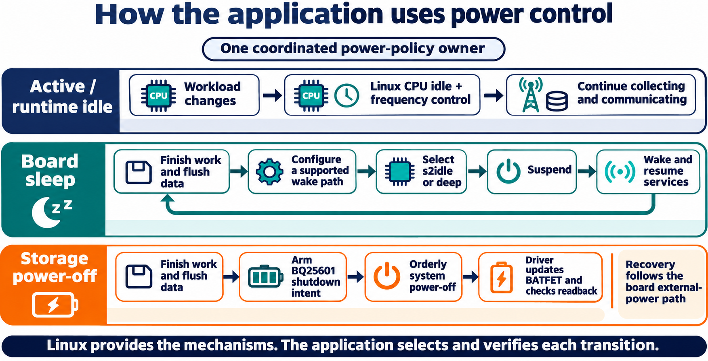
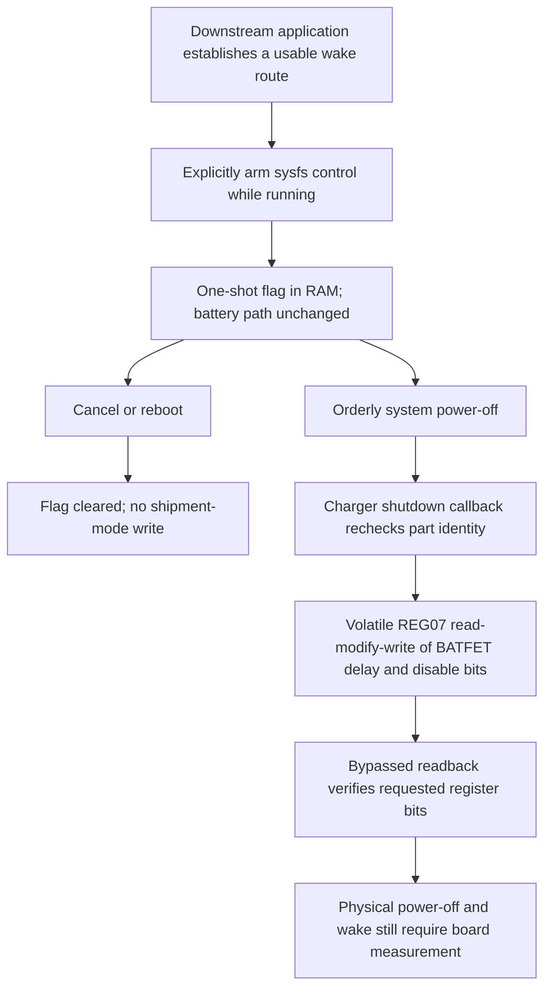

# BQ25601 ship mode on graceful power-off



This optional GPLv2 kernel change targets the TI BQ25601 charger on the iWave
Telematics Connect Hub G62H i.MX91 REL3.3 profile. It is not a general suspend or
battery-management driver and does not establish support for other BQ256xx parts.

## Why this change exists

A halted CPU does not necessarily disconnect the backup battery. A low-current
power-off state needs an explicit charger BATFET operation, performed late enough
that storage and system shutdown can finish first. Earlier arming must not cut power.
The challenge is that charger register caching can hide the current silicon state,
while reboot and shutdown paths must remain different and a stale request must not
survive a later boot.

The patch adds RAM-only `ship_mode_on_poweroff` opt-in through the charger device's
sysfs attribute. Arming validates both the configured BQ25601 model and the physical
part information through a bypassed regmap read. Arming/cancelling changes no BATFET
register. Only graceful system power-off consumes the request; reboot does not.
The shutdown hook sets the BATFET delay and disable bits, preserving unrelated bits.
Relevant charger control bits are marked volatile so live register values are used.
The feature starts disarmed, reports errors and does not manufacture a success result.

An application must establish a real wake path for its power mode before opting in.
This repository supplies the mechanism, not an unattended energy policy or a promise
that ignition, modem or CAN can wake a board whose battery path was disconnected.
Physical current, rail sequencing and wake measurements remain required.

## Background: three separate power responsibilities

The supplied BSP already provides the `bq256xx` charger driver and board battery
configuration. Its REL3.3 patch series includes charging-current initialization
and a probe-time write of register 0x07 to 0x4c. Those are vendor boot/charging
changes. This extension retains them and adds a separate, one-shot shutdown
mechanism. The charger is built into the qualified kernel with
`CONFIG_CHARGER_BQ256XX=y`.

Deciding *when* a device may shut down belongs to an energy-management application.
It must consider its workload, storage, external power, battery state and actual
wake route. Performing the final BATFET operation belongs to the kernel driver.
The stock `battery_monitor.service` is a third responsibility: factory protection
retained in the neutral image, with its original binary and runtime library.
Installing this patch does not replace that monitor or install a new automatic
energy manager.

## Useful power states and their owners

A running device can use several different power mechanisms. Each serves a
different operational need, so an integrator chooses a state from the required
work and proven wake route rather than treating every low-power state as sleep.

| State or mechanism | Useful behavior | Owner of the decision and integration |
|---|---|---|
| OS active | Linux and applications execute the current workload and service incoming work. | The application defines what must remain available. |
| Runtime idle and device runtime PM | Linux stays running while idle CPUs/devices can use the idle or runtime-PM behavior supported by their drivers. | The kernel, device drivers and application workload determine which resources can idle. |
| Platform suspend | Linux enters a platform sleep state and resumes through a configured wake source, with device state handled by the suspend/resume path. | Board/kernel integration establishes supported states and wake sources; the application decides when the prepared state is appropriate. |
| Orderly power-off | Services and the OS complete shutdown; returning to operation follows the board's boot/power-on path. | The shutdown manager coordinates the OS lifecycle and the board provides the power-on route. |
| Charger shipment mode | The BQ25601 BATFET mechanism can disconnect the backup-battery path after the requested delay. | This extension supplies the supported-part shutdown hook; downstream policy establishes when to arm it and how the board will regain power. |

This patch connects explicit application opt-in to the final charger operation
in an orderly power-off. Existing Linux idle, runtime PM and platform suspend
remain separate integration mechanisms. The board's usable wake paths and the
state of its external supply determine which mechanism is appropriate. Current
and wake behavior must be measured for that exact state; the table assigns roles
and does not rank measured energy consumption.

## Activation and actual effect

The `ship_mode_on_poweroff` attribute belongs to the matched charger's I2C device
in sysfs. It is published only if the model and bypassed silicon-identity check
succeed. A downstream controller must discover the correct device, explicitly arm
it while the system is running and read back the armed state. Arming means the
RAM flag was accepted. It is not a readback of a disconnected battery.



Only `SYSTEM_POWER_OFF` uses the armed request. The shutdown callback consumes the
flag, checks the part again and updates REG07 bits 5 and 3 while preserving the
other live bits. Readback failures are errors. Reboot consumes the request without
performing that BATFET write, and a new boot does not inherit a pending arm request.
Unexpected loss of supply is not an orderly callback and is not covered by this
one-shot contract.

The neutral base starts disarmed and retains factory battery protection. A
downstream energy manager supplies shutdown timing and verifies the electrical
wake route for its chosen state. Timer-based resume, where supported by the
platform, belongs to its separate wake integration. Delayed BATFET disable here
selects a shipment-mode operation; its delay is not a periodic timer that powers
the computer back on. Unattended use depends on a verified way to regain power
from that exact electrical state.

The intended improvement is an explicit and auditable way to request a lower-power
*off* state after orderly shutdown. This is different from suspend, CPU idle or
runtime autosuspend. No battery-current measurement, battery-life extension or
wakeup reliability result is supplied by this patch or its host test. A successful
register message explicitly leaves physical power-off unconfirmed; actual rail
behavior and recovery must be measured on the target board.

## Exact inputs and checks

`source.json` pins the upstream revision, REL3.3 vendor-patched source path, pre/post
SHA-256 and patch identity. Base revision is
`02cf250c2e6bd375c11dae324ea145a39015d41b`, with all 15 supplied REL3.3 patches.
Apply from this repository root to an owned, prepared Linux tree:

```sh
python3 -B tools/kernel/apply.py --source /path/to/linux --with-energy
python3 -B tools/kernel/apply.py --source /path/to/linux --with-energy --check
```

Unknown sources, modified patches and partial application are refused. Hashes of the
complete resulting driver are checked; patches use zero fuzz and zero offsets.
These commands do not build, load or install software and do not contact a device.

`native_test.py` extracts the production hook block after applying the exact patch
and compiles it with `native_harness.c`, using an injected regmap/sysfs boundary.
It covers model/part identity, register-read/write failures, arm/cancel, reboot versus
power-off, request consumption and preservation of unrelated register bits.
Use a pre-patch driver file with the exact `preSha256` from `source.json`:

```sh
python3 -B components/bq25601-poweroff/native_test.py \
  --source /path/to/pre-patch/bq256xx_charger.c --report /path/to/native-report.json
```

This host test does not establish kernel integration, physical BATFET timing, current
consumption, brownout safety or wake behavior. The kernel build and static loader
qualification are separate checks; hardware acceptance is a separate explicit step.
