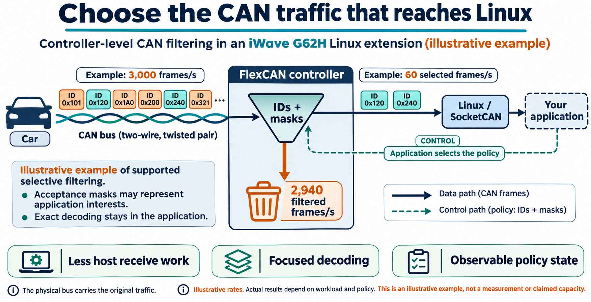
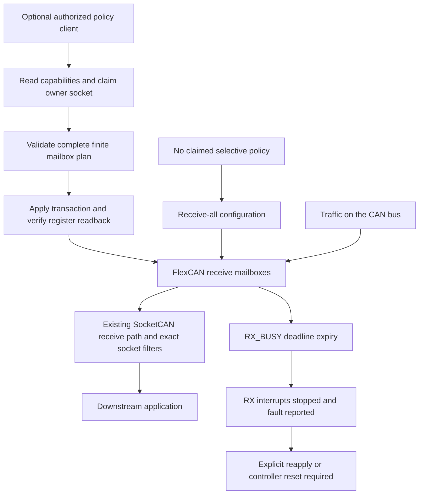

# iWave REL3.3 FlexCAN controller policy



This package implements the `omam_flexcan` Generic Netlink v1 ABI in
`include/uapi/linux/omam_flexcan.h`. It is qualified
in source for the i.MX91's `fsl,imx93-flexcan` controller, RX mailbox mode with EACEN/RRS,
and `CONFIG_CRYPTO_LIB_SHA256=y`. It does not create a CAN data receiver or transmit
CAN frames. Other FlexCAN IPs report unsupported and retain stock filtering.

The base is `linux-imx9-iwave` SRCREV `02cf250c2e6bd375c11dae324ea145a39015d41b`
plus all 15 supplied REL3.3 patches. None of those patches changes the three files
modified by `0001-flexcan-controller-policy.patch`. `manifest.json` pins each base
and result file. The new C/headers in this directory are the source of truth for the
four overlays. The patch contains only the three existing driver files. The source
acquisition receipt remains responsible for all other BSP inputs.

From the repository root, with an explicitly prepared source directory:

```sh
python3 tools/kernel/apply.py --source /path/to/prepared/linux
python3 tools/kernel/apply.py --source /path/to/prepared/linux --check
```

Application validates every base and new overlay before writing, performs a patch
dry run, and verifies all seven results. An already applied exact result is a no-op.
An unknown or partly applied input is refused. Neither command compiles, installs,
loads modules, changes services or contacts a device. The integrated image build owns
kernel/DTB/module ABI verification and device qualification.

## Original problem, implementation and limits

SocketCAN socket filters run after controller reception. They cannot prevent irrelevant
bus traffic from consuming receive mailboxes, interrupts and driver work. Under two-bus
bursts the important challenge is to reduce controller admission without starving a bus,
silently dropping a requested rule or claiming that a policy was programmed when hardware
rejected it. This extension adds an explicitly owned cold control path for hardware RX
mailbox policy and readback. It leaves the stock receive-all behavior when unclaimed.

For a concrete illustration, consider a vehicle bus carrying 3,000 frames per
second while the application needs the IDs accounting for only 60 of those frames.
With socket-only filtering, controller reception and some host driver work still
happen for the unwanted traffic. If the required selection fits the controller's
mask/mailbox model, a selective hardware policy can reject much of that traffic
before it reaches the host receive path. The vehicle's messages still exist on the
wire; this changes local admission rather than the traffic generated by other ECUs.
These rates are illustrative, not a measurement, a sustained-capacity result or a
claim about CAN wire bandwidth on this board.

The difficult parts are finite mailbox capacity, overlapping ID masks, receive rearming,
Classic versus FD layouts, live transitions, owner loss and rollback after partial MMIO
failure. The compiler produces an entire bounded mailbox plan before touching hardware;
the transaction reports actual mode, generations and recovery state. The legacy `omam_`
prefix identifies the stable public wire ABI and source symbols. It carries no application
binary, deployment profile, SIM settings or account identity.

This is not a generic CAN performance claim: IRQ reduction, bus fairness, physical mask
behavior and wake behavior need independently transmitted traffic on the target board.
No new support is claimed for another iWave model or controller revision.

## What changes in an image and at runtime

The extension is compiled into the existing FlexCAN driver with
`CONFIG_CAN_FLEXCAN=y`. It adds a controller-control interface; SocketCAN remains
the frame data interface. Installing this kernel does not start a CAN consumer,
select a vehicle parser, configure a bus bitrate or choose a receive policy.
The neutral base contains no application policy owner. A supported controller
therefore starts in receive-all mode until an authorized client explicitly claims
and changes it. The RX_BUSY protection described below is part of the patched
receive path and does not wait for an application to request selective filtering.

A downstream policy client first reads capabilities for the actual interface. It
keeps one long-lived owner socket, validates the complete intended mailbox plan,
requests replacement and checks the resulting hardware state. The normal data
consumer continues to use its own SocketCAN filters. Controller masks reduce
admission earlier in the path; exact application filters remain necessary when a
hardware rule deliberately admits a broader group of IDs.



| Situation | Before the extension | With this extension |
|---|---|---|
| Irrelevant IDs on a busy bus | Socket filtering happens after controller reception and driver work. | A claimed selective plan can reject IDs in controller hardware before that work. |
| Policy too large for the current mailbox layout | No application-owned plan contract. | Whole-plan validation fails explicitly; no requested rule is silently dropped. |
| Client closes or controller state changes | No lease/readback contract for an application plan. | Owner epochs, generations, recovery status and actual applied mode expose the change. |
| Mailbox remains RX_BUSY | The supplied receive loop could poll without a bound. | A 1 microsecond polling interval and 250 microsecond bound replace that loop; expiry records a fault and stops RX interrupt admission. |

The expected benefit of selective admission is less irrelevant receive work. This
repository does not quantify the reduction, prove two-bus fairness or establish a
maximum sustainable frame rate. Replica counts allocate scarce mailboxes; they do
not create an unbounded queue or an automatic fairness scheduler. Standard and
extended IDs and RTR matching have explicit rules. A mask cannot select Classic
versus FD data frames with the same accepted identifier, so requests claiming that
capability are refused rather than approximated.

RX_BUSY expiry is visible degradation, not successful reception. The fault counter
and state allow a consumer to stop claiming readiness and arrange recovery. Keeping
TX/error handling separate does not prove that a faulted receiver can safely ACK,
wake on an ID or continue receiving. Those physical semantics need target tests.

## Wire and ownership

Resolve the family through `GENL_ID_CTRL`; do not pin its runtime numeric ID. Send
exactly one binary attribute, type 1, containing a 1128-byte request. The reply has
one type-2 binary attribute with a 1168-byte response. Header version is 1 and all
struct integers are little-endian. The command also appears inside the request.
All reserved fields and unused entries must be zero. The entry layout is 16 bytes:
ID, mask, replica count, standard/extended format, RTR policy, frame kind, reserved.

GET_CAPS and GET_POLICY contain only ABI version, ifindex and command. Mutating
operations and VALIDATE carry the returned controller instance, expected generations,
owner epoch, a strictly increasing nonzero request ID, profile identity and SHA-256
of the complete request with the payload-digest field zeroed. CLAIM uses epoch zero;
CLEAR/RELEASE/CLAIM require receive-all, zero entries and zero profile identity.
VALIDATE compiles a complete plan without MMIO or policy-generation changes.

The owner is a long-lived Generic Netlink socket, authenticated with the sender's
network-namespace CAP_NET_ADMIN. The kernel retains that actual socket and uses its
kernel cookie for replay authorization. It never ties a claim to an RX socket.
Ifindex or netlink portid reuse cannot acquire an old lease. Closing the owner socket
schedules bounded cleanup; cleanup checks the departed epoch before changing state.
Namespace moves clear ownership and renew controller identity. Physical removal
cancels owned work before private memory is freed.

One full request is retained for idempotent replay. Identical last requests return
current status with REPLAY; changed bytes using that ID and older IDs are refused.
After a reset, loss or capacity fallback, a replay may return a different actual
policy than the original response. Callers must compare current generations, digest,
mode and READBACK instead of interpreting a repeated result code as readiness.

## Controller behavior

A new controller starts with receive-all. SELECTIVE assigns complete OR rules and
explicit replica counts to ascending RX slots, leaving unused slots inactive. MB0
and the final TX mailbox are reserved. Capacity is 62 in Classic mode or 12 with
64-byte FD mailboxes; replicas consume that same pool. No hidden buffer reserve,
rule truncation or compiler coverage claim exists in the driver. Overcapacity
returns ENOSPC. The caller chooses measured replica allocation or an explicit
receive-all fallback while retaining exact socket/application filters.

Masks preserve IDE and optionally RTR. EDL is not an RXIMR acceptance bit, so
Classic-only or FD-only entry requests return EOPNOTSUPP; ANY admits both data-frame
kinds permitted by the configured controller. FD mode can still receive Classic
RTR frames. A received ID only replaces ignored ID bits or matches the configured
ones, so no new per-frame rearm writes are added. Physical repeated-mask behavior
still requires device qualification.

Live application stops TX admission, synchronizes IRQs and refuses a pending TX.
It quiesces NAPI, drains queued old-generation frames, freezes, programs every RX
slot and verifies its mask/ID/control readback, then unfreezes. Failures attempt the
previous complete policy and then receive-all. If neither succeeds, the controller
is made unavailable and no successful filtering/readiness is reported. A receive-gap
sequence exposes transitions; there is no fabricated hardware rejection counter.

Down-state requests stage the desired policy. They return `applied_mode=UNAVAILABLE`
and no READBACK. Open/down-up, bus-off restart and resume reapply before readiness.
A Classic-to-FD policy which no longer fits becomes explicit receive-all with a new
policy generation and CAPACITY recovery status. Owner loss restores receive-all or
marks reception unavailable when hardware cannot establish it. RX_BUSY polling is
bounded; expiry suppresses RX IRQ admission, exposes the fault and requires reapply
or reset. TX and error handling are separate.

`mode` and entries describe the committed desired policy. Actual readiness requires
`result == 0`, `applied_mode == mode`, READBACK, correct policy/profile identity and a
usable link state. READBACK refers to verification at programming time; live RX
mailbox contents naturally change. The application must coordinate both controllers;
this ABI provides no cross-controller atomic commit and no wake-on-selected-ID claim.

## Verification boundary

`tests/native/flexcan/run.sh` compiles and executes the actual portable compiler,
authorization checks and bounded transaction/recovery logic with UBSan. Independent
literal register vectors, exhaustive standard IDs, extended/J1939 groups, format/RTR,
capacity, replay and scripted hardware faults protect the cold control path.
`patch_test.py --source /path/to/prepared/linux` checks application, idempotence and
refusal using a small disposable three-file vendor fixture, not a repository copy.

These tests do not establish kernel compilation, hardware MMIO behavior, pending-TX
races, real socket-close notification, PM/wake, error IRQ behavior or receive throughput.
The retained candidate was compiled and statically qualified. Physical observations
remain NOT RUN and are never inferred from these native checks.
That later validation includes two-bus bursts, repeated masked reception, accept-none
ACK/TX semantics and controller rejection against independently transmitted counts.
No device operation is performed by this package's preparation or native tests.
