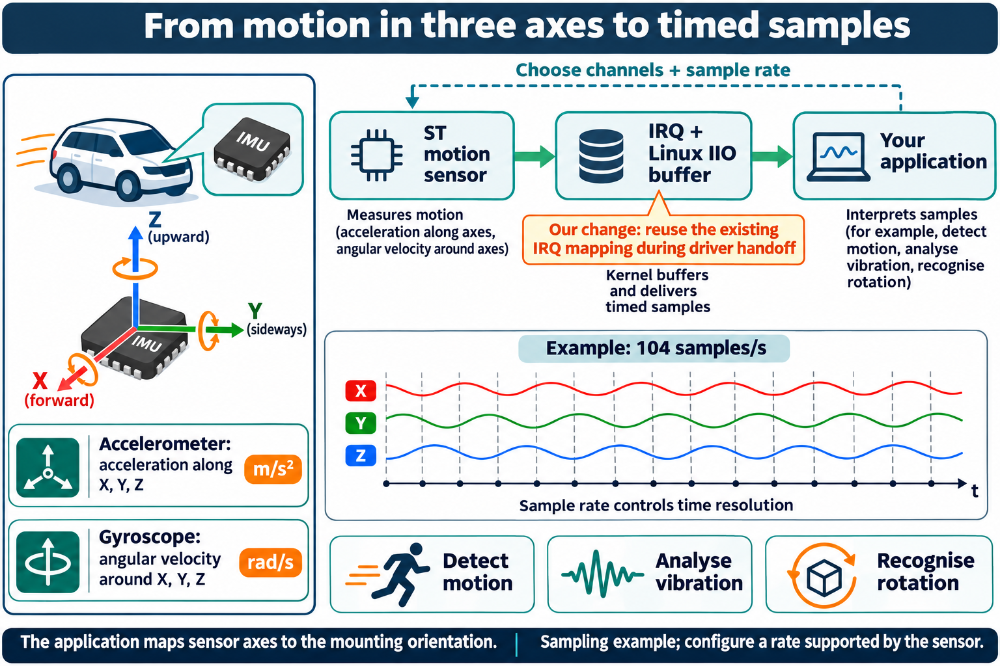
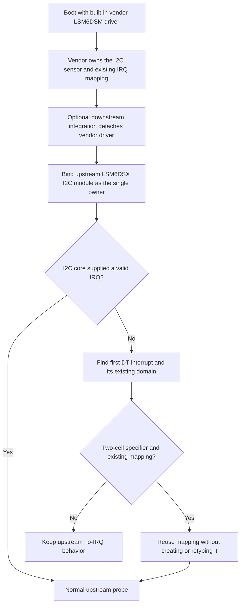

# Reuse the existing ST LSM6DSX interrupt mapping

This GPLv2 patch targets the iWave Connect Hub G62H i.MX91 REL3.3 device-tree path
for the `st,lsm6dsl` I2C IMU and gpio-vf610 two-cell interrupt domain. It is a narrow
compatibility workaround for vendor-driver handover, not a new accelerometer driver.
The actual sensor support comes from upstream `st_lsm6dsx` core and I2C modules.

## Original failure and the change

The vendor built-in `st_lsm6dsm` driver requests GPIO3 line 22 as level-high at boot,
although the device tree declares a rising edge. This changes the existing mapping.
After vendor-driver unbind the I2C core attempts to map the interrupt again, the IRQ
domain refuses the type mismatch and the new client receives no IRQ. On this kernel
that leaves triggered buffers unable to deliver the required IMU data.

When `client->irq <= 0`, the patch parses the node's first device-tree interrupt,
finds its existing interrupt domain and looks up the already allocated hardware IRQ
mapping. It neither creates a mapping nor changes its trigger type. It passes that
existing IRQ to `st_lsm6dsx_probe` and logs the fallback once. A valid IRQ follows the
unmodified upstream route. Missing nodes/domains/mappings or non-two-cell specifiers
retain the upstream no-IRQ behavior.

The hard boundary is driver ownership: the vendor driver must be detached before the
replacement binds. This patch does not perform takeover, configure FIFO/calibration,
change mount orientation or publish application data. No claim is made that this
fallback fixes other IRQ domains, board revisions or sensors. It must not be used to
hide an unrelated IRQ allocation/configuration fault.

## Which drivers are in the base image

The retained vendor source adds the `st_lsm6dsm` driver. In the qualified kernel,
`CONFIG_ST_LSM6DSM_IIO=y`, `CONFIG_ST_LSM6DSM_I2C_IIO=y` and
`CONFIG_ST_LSM6DSM_SPI_IIO=y`, so the vendor driver is built into Image rather than
being one of the shipped loadable modules. Its Kconfig describes support for
LSM6DSM/LSM6DSL. These software names and Device Tree compatibles do not by
themselves establish the fitted sensor's physical identity on every hardware option.

The upstream `CONFIG_IIO_ST_LSM6DSX` option is disabled in that configuration.
Instead, the qualification recipe explicitly builds `st_lsm6dsx.ko` and
`st_lsm6dsx_i2c.ko` as external modules against the same kernel headers and symbol
table. Their editable upstream sources come from
`drivers/iio/imu/st_lsm6dsx/`; this patch is applied to the separate external-module
source directory. The two modules and their depmod entries are installed under
`usr/lib/modules/<release>/updates/omam/`. Installing that pair does not disable or
unbind the built-in vendor driver.

The retained patch rationale records the interrupt mismatch encountered during a
vendor-to-upstream handoff. That is the background for this workaround, not a new
measurement of the present neutral image. A built-in driver can already own the
sensor and its interrupt when a later module becomes available. A second driver
must not simultaneously take ownership of that same I2C device.

## What an application reads: six axes and sample timing

This IMU family provides three accelerometer axes and three gyroscope axes. The
upstream driver exposes X, Y and Z acceleration channels and X, Y and Z angular
velocity channels through Linux IIO, with timestamps for buffered acquisition.
The application converts the signed raw values using the device's advertised
scale and any applicable offset, then maps the sensor axes into its installation's
coordinate system.

| Stream | Physical quantity after IIO conversion | Example use by an application |
|---|---|---|
| Accelerometer X/Y/Z | Acceleration in metres per second squared, `m/s^2` | Observe motion and gravity relative to the fitted sensor axes. |
| Gyroscope X/Y/Z | Angular velocity in radians per second, `rad/s` | Observe rotation about those axes. |

ODR means output data rate in hertz, or nominal readings per second for a sensor
stream. In this pinned upstream driver's LSM6DSL/LSM6DSM/ISM330DLC settings group,
the accelerometer and gyroscope ODR tables each list **12.5, 26, 52, 104, 208 and
416 Hz**. The implementation stores milli-hertz, so table entry `104000` means
104 Hz, not 104,000 readings per second. Other sensors supported by the driver
have their own tables. These are driver-supported settings for the selected
sensor group, not a new maximum supplied by this IRQ patch.

At a configured 104 Hz, the accelerometer nominally produces 104 X/Y/Z readings
per second; a gyroscope configured at 104 Hz has its own three-axis stream. That
is different from an application polling a file 104 times per second. Buffered
acquisition can deliver multiple timestamped readings in one batch or interrupt,
and the host must keep up with the chosen channels and rate. The application
selects a value reported by `sampling_frequency_available`, reads back
`sampling_frequency` and configures scan channels, buffers and FIFO watermark.
The driver can round an intermediate requested ODR up to a supported table entry;
reading the chosen setting avoids treating the requested number as the actual one.

The existing-IRQ change restores a specific interrupt connection needed by the
upstream data path after handoff. The upstream driver and sensor already define
the supported sample rates and conversion scales. Sample continuity depends on
IRQ delivery, FIFO service and the consumer; measurement quality depends on the
sensor, range, calibration and installation. Applications own orientation and any
motion/event interpretation. The patch itself does not raise ODR or establish
better physical accuracy.

## Runtime handoff and integration responsibilities

The fallback is deliberately narrow: it uses `irq_find_mapping` for the existing
mapping and assumes the first cell is the hardware IRQ number in this two-cell
gpio-vf610 domain. It does not invent an interrupt or force a new trigger type.
The original mismatch is therefore not hidden behind a claim that all interrupt
configuration faults have been repaired.

The neutral image installs the alternative modules but contains no automatic IMU
ownership-takeover service. A downstream integration must deliberately manage
exclusive ownership, bind the intended driver, verify the actual IIO device and
interrupt delivery, and configure the channels, sample rate and buffers it needs.
It must also handle failure and return to a known driver state. Module installation
or successful symbol checks alone cannot establish that this handoff occurred.

The intended effect is to let the upstream probe use the already allocated IRQ
when the documented remapping conflict would otherwise supply no interrupt. Once
that path is working, the upstream driver supplies its normal IIO channels and
buffering interfaces. The application chooses thresholds, calibration and mount
orientation for its own interpretation of those readings. Continued sample
delivery, conversions, FIFO behavior and suspend/resume remain target acceptance
criteria for the chosen owner and configuration.

## Exact source and build route

The patch records its original source provenance. Base is `linux-imx9-iwave` revision
`02cf250c2e6bd375c11dae324ea145a39015d41b`; the unmodified I2C source SHA-256 is
`2153bdfecdb45afd95e002a6a5ebb4d07e9357c100221c6dbba13b925029bb1c`.
The immutable patch bytes are retained so already qualified module provenance remains
verifiable. Historical report names in the patch description are provenance text,
not required files or build dependencies of this project.

`tools/kernel/qualify.py` builds only core and I2C front ends as external `obj-m`
modules against the exact candidate headers, configuration and `Module.symvers`.
It applies the patch with zero fuzz, strips debug information and verifies symbol
CRCs, export namespaces, GPL-only imports, module layout, relocations, vermagic and
dependency resolution. The aggregate manifest pins the resulting two modules and
kernel Image. The pure Image export parser is local to `tools/kernel/image_exports.py`;
no application installer or private source is imported.

The `omam_` prefix in retained patch text and manifest contracts identifies the
original extension and compatibility format; it does not install an OMAM application.
Host/static checks do not prove interrupt delivery, sample continuity, FIFO overruns,
calibration, suspend/resume or physical driver takeover. Those remain board checks.
