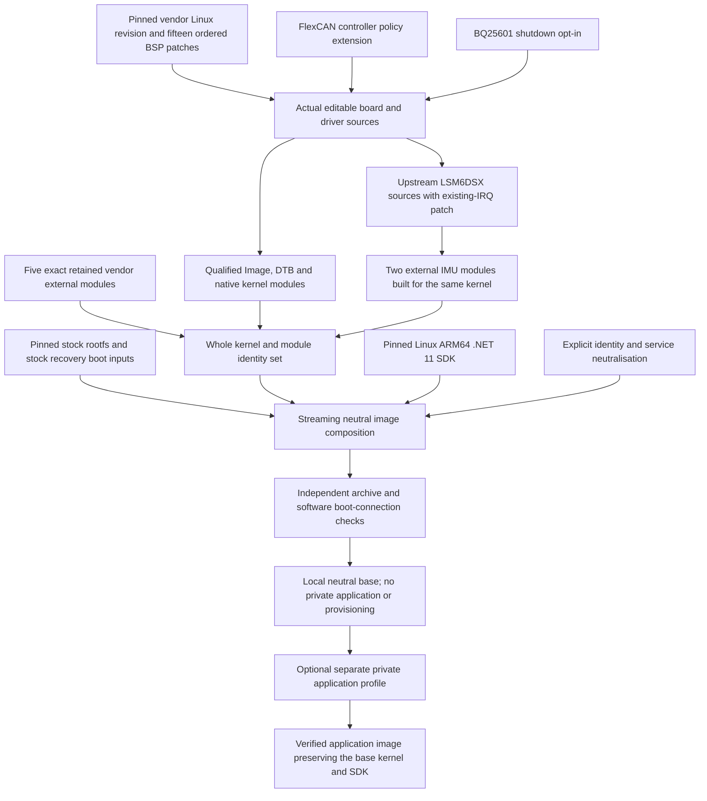

# Architecture and verification contracts

The unit of compatibility is a hardware profile. A profile fixes the vendor input
identity, source revision and patch sequence, Device Tree, kernel configuration,
module set and SDK. The component directories own mechanisms; the profile decides
where those mechanisms are valid. A controller feature flag is not a board-level
qualification, and a working source build is not a measurement of wake current.

## What the local image is made from

The first image profile is the Telematics Connect Hub G62H development hardware
with NXP i.MX91, Linux 6.12.34 and the supplied TCH REL3.3 BSP. REL3.3 names that
board delivery. Its last vendor patch changes the printed BSP version; it does
not itself add a new CAN policy, automatic energy manager, upstream sensor driver
or .NET runtime. The complete ordered fifteen-patch vendor baseline remains an
input to the separately maintained extensions.

| Input or transformation | Resulting role |
|---|---|
| Qualified `Image` and `imx91-iwg62h-prgtt.dtb` | Kernel mechanisms and the board's actual hardware description are selected together. |
| 807 native modules, five preserved vendor modules and two upstream IMU modules | One release-specific module set with matching symbol and dependency metadata; built-in drivers are additional code inside Image. |
| .NET SDK `11.0.100` | Full ARM64 SDK under `/opt/dotnet`, with the exact `11.0.0` shared runtimes; it is a userspace payload, not a kernel driver. |
| Neutral overlay | Clears stored connections and identity, locks password accounts, selects headless boot and disables consumers of deliberately removed configuration. |
| Original factory protection and peripheral entrypoints | Retains battery monitor/runtime library, BLE initialization, GNSS socket activation and SSH key-generation services without adding private operational policy. |
| Separate downstream profile | Adds its own application, release, access and deployment configuration only after validating the neutral base. |

This is a local composed base, not an image captured from a configured device. Its
inputs do not include the private application, SIM/APN, device identity, deployment
certificates or server configuration. The stock library used by factory protection
remains the one from the pinned rootfs; an independently supplied library with a
similar name is not silently substituted.

## Installed mechanism versus active policy

The three extensions solve different problems and have different activation paths.
Having their bytes in the same image does not make them one automatic controller.

| Mechanism | Why the stock path needed an extension | Neutral-image state | What a downstream integrator must do |
|---|---|---|---|
| FlexCAN controller policy | Socket filters act after controller reception; finite hardware mailboxes require complete-plan validation and honest recovery/readback. | Patched built-in driver and Generic Netlink ABI are available; no application claims a selective policy, so reception starts receive-all. Bounded RX_BUSY fault handling is already in the patched receive path. | Claim a long-lived authorized control socket, validate/apply its complete policy and verify actual mode, generations and readback; retain exact SocketCAN/application filtering. |
| BQ25601 ship-on-poweroff | CPU shutdown alone does not request delayed BATFET disable; doing that at arm time would cut the wrong part of the lifecycle. | Patched built-in charger starts disarmed. Factory battery protection remains enabled. No new automatic energy manager or wake schedule is installed. | Establish a real wake route, explicitly arm the correct supported charger while running, perform orderly power-off and separately measure the physical result. |
| ST LSM6DSX existing-IRQ fallback | A recorded vendor-driver handoff can leave an existing level-high mapping that conflicts with a new Device Tree remap. | The vendor LSM6DSM driver remains built-in; the upstream core/I2C pair is installed as external modules. No service automatically takes ownership away from the vendor driver. | Arrange exclusive driver handoff, confirm the actual IIO/IRQ state, then configure channels, sample rate, buffers and failure recovery. |

A concrete CAN motivation is early selection under high vehicle message volume.
For illustration, a bus could carry 3,000 frames per second while only IDs making
up 60 of those frames are needed by an application. Hardware admission can save
host receive work for traffic excluded by an expressible controller policy;
SocketCAN/application filtering still supplies the final selection. This example
is not measured traffic, a throughput limit or a CAN wire-bandwidth claim. Other
ECUs keep generating their messages on the physical bus.

The IMU exposes two three-axis streams: acceleration X/Y/Z, converted through IIO
scale to `m/s^2`, and angular velocity X/Y/Z, converted to `rad/s`. For the pinned
upstream LSM6DSL/LSM6DSM/ISM330DLC settings, each stream supports 12.5, 26, 52, 104,
208 and 416 Hz. At 104 Hz a sensor stream nominally generates 104 three-axis
readings per second, which can reach an application in FIFO/buffer batches rather
than one reading per application poll. The application chooses the supported ODR,
scan channels, buffer/watermark, conversions and installation orientation. The
IRQ handoff fix makes the existing upstream interrupt path usable in the recorded
conflict; it does not redefine the sensor's rates or measurement accuracy.

Power integration also has distinct operational states. Active Linux services do
work; runtime idle/runtime PM can idle supported resources while the OS remains
running; platform suspend uses a supported sleep/resume and wake path; orderly
power-off ends the OS session and returns through the board's power-on path.
BQ25601 shipment mode adds a requested charger BATFET operation during that final
power-off path. The kernel and board supply mechanisms, factory protection guards
its existing boundary, and a downstream energy manager chooses when the required
work and verified wake route allow a transition. Actual current and wake results
belong to measurements of the selected state, not to the names of these modes.

For CAN, a successfully validated plan is not yet a successfully applied plan.
The controller's mask hardware distinguishes identifier format and RTR but cannot
select Classic versus FD data solely through RXIMR. Classic layout has 62 usable
RX slots; 64-byte FD layout has 12, and replicas consume those slots. A broad mask
may deliberately admit IDs the application later rejects. Neither that policy nor
the busy-loop bound proves loss-free reception, two-bus fairness, CAN ACK semantics
or wake-on-selected-ID behavior on a physical bus.

For power, arming only changes RAM. The final supported-part check, volatile REG07
read/modify/write and bypassed register readback happen in the graceful power-off
callback. Reboot does not perform that write. The patch adds no RTC timer wake or
automatic energy decision, and its successful register message does not measure
current or establish that a disconnected backup-battery path can wake again.

For IMU, built-in `CONFIG_ST_LSM6DSM_IIO=y` and its I2C/SPI options describe the
retained vendor driver. `CONFIG_IIO_ST_LSM6DSX` remains disabled in the qualified
configuration; the alternative pair is explicitly built externally against that
same kernel. Its IRQ patch only looks up an already existing mapping when the
I2C core supplied no usable IRQ. It does not create/retype that mapping, detach the
vendor owner, select orientation/calibration or deliver application motion events.

## Source and binary identity

The first profile starts with an iWave-pinned Linux revision and fifteen ordered
vendor patches. The FlexCAN overlay manifest binds the base and result hashes of
all affected files. The charger manifest binds its original source, patch and
post-image. The IMU patch binds the external module's source and the expected IRQ
assumptions. Check/apply commands refuse a different source; they do not accept a
close-looking version or apply a patch with arbitrary offsets.

The compiled kernel set records Image, DTB, configuration and symbol/map outputs.
It inventories every module and depmod index, including the five exact stock
external modules and the upstream IMU pair. Qualification compares symbol CRCs,
module layout, relocation support and loader version semantics. Counting files or
comparing only vermagic would miss important incompatible states.

The Image export parser is its own public module. Its PREL32 chain assembly keeps
chains by stride and offset rather than extending only whichever chain was seen
last. A synthetic interleaving regression detects the older behavior that selected
a shorter apparently valid sequence. The real qualified Image was also compared
with the independent Module.symvers export table. That combination checks both a
specific failure mode and the actual candidate without executing vendor binaries.

## Neutralisation as an explicit transformation

The stock rootfs is an immutable input. A declared overlay plan lists each deletion
and replacement. Composition streams the input into a new archive and preserves
all untouched entries. This makes changed ownership, unexpected hardlinks, missing
parents and unplanned overwrites observable rather than relying on a shell copy.

Neutralisation is profile-specific. It removes stored connections, SIM/PPP state,
old machine/host identity and demonstration home data; it locks password accounts.
It does not search the whole source tree with a generic credential heuristic or
silently modify the original acquired input. An independent reader inspects the
actual output, not just the list of intended deletions.

Removing configuration also changes service dependencies. The stock graphical
target needed a home directory that no longer existed, and the stock modem setup
expected a PPP peer file that was deliberately absent. The neutral profile therefore
selects headless multi-user boot and masks those consumers until an installation
profile provides a replacement. The factory battery monitor's enablement,
executable and library are verified as a connected path. Physical effectiveness
remains an instrumented device test.

## Private additive profiles

A private application profile is a separate producer. It validates the public
base before any publication or privileged installation work, adds its declared
application/configuration overlay and verifies retained content against that base.
The overlay composer does not add a second SDK. Kernel/modules may be temporarily
made visible to an offline installer for validation, but they are not changed in
the final base content.

Application signing, per-device certificate issuance, SIM/APN settings and server
configuration belong to the downstream application. Their absence from the public
base is deliberate and checked. Public source/ABI identifiers that retain an
original project prefix do not constitute application provisioning.

## Evidence levels

| Evidence | What it establishes | What it leaves open |
|---|---|---|
| Source/hash check | Exact reviewed inputs and declared changes | Compilation and runtime behavior |
| Native test | The exercised algorithm/refusal behavior with independent expectations | Real CAN controller, sensor or battery behavior |
| Kernel build | The selected source/config/toolchain can produce outputs | Correct module loading and physical effects |
| Static ABI qualification | Declared loader contracts and exact module/index identities | Actual boot, traffic, interrupts and wake |
| Archive acceptance | Actual kernel/SDK/configuration content and software boot connections | Physical flash/boot and measured power behavior |
| Hardware measurement | The observed device, installation and workload | Untested boards, indefinite operation or different conditions |

Source-only delivery and locally composed firmware also have separate release
boundaries. The preferred-source archive includes the actual modified Linux tree,
board additions, upstream IMU sources and patch/recipe, public build tools and
qualified configuration. It explicitly remains incomplete for the five retained
factory external modules. Matching source for those modules and redistribution
terms for vendor runtime/firmware must be resolved before treating the local
complete firmware as publicly redistributable. Private application configuration
is not a substitute for either source evidence or vendor rights.

A release report should state each level separately. Skipped tests, an empty suite,
an absent compiler or an unavailable device are not passing evidence. A repaired
input invalidates only the checks it actually changes. Preserve an earlier failed
result as failed when later scoped replacements are accepted.
