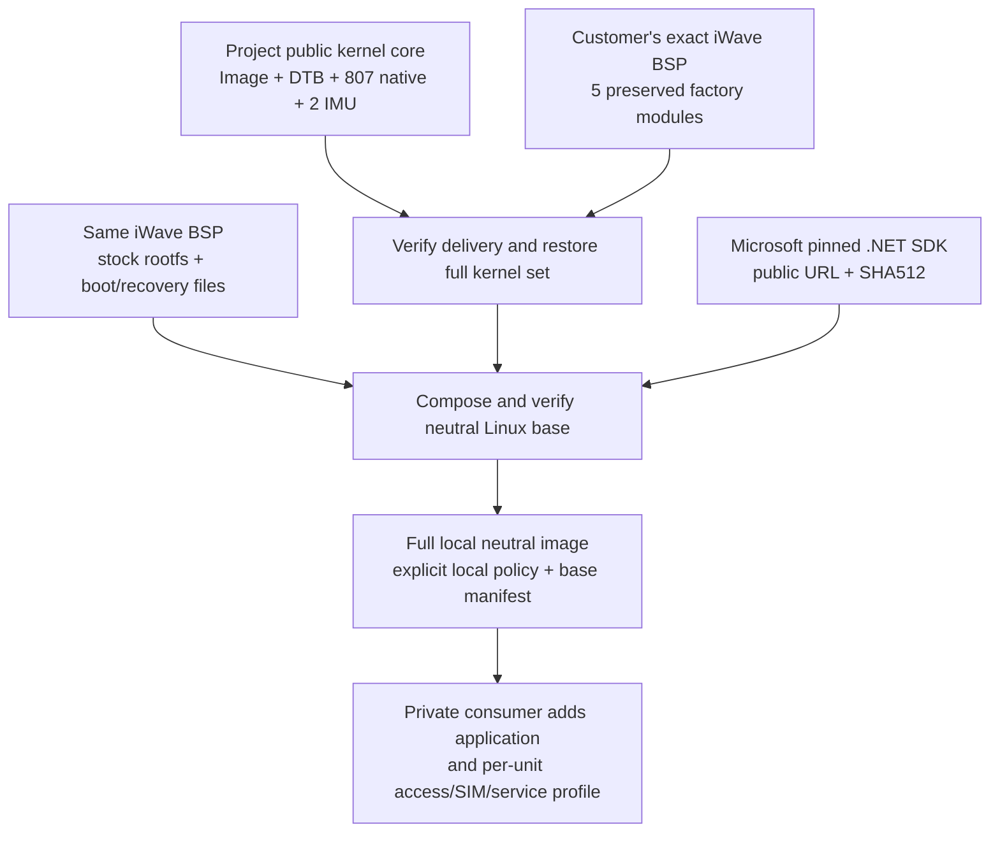

# Assemble a neutral TCH image from the public kernel core

## Delivery status and purpose

The **v0.2.0-kernel-core** delivery supplies a statically qualified GPL kernel
core. `profiles/tch-g62h-imx91-rel3.3/kernel-core-release.json` binds the release
asset's URL, size and SHA-256. The 27,160,373-byte archive contains 809 modules;
the five factory-module binaries are deliberately supplied from your exact BSP.
The separate source archive is preferred editable Linux source, not this binary
bundle. Neither archive is a complete firmware image.

The full native build and 814-module static qualification passed. Actual acceptance
then extracted the core, restored its five factory modules without a compiler,
composed a neutral image with the pinned SDK and validated it through a downstream
consumer with an explicit local policy. `build-verification.json` in the same profile
records hashes and the scope. This run used ARM64 Ubuntu 26.04; physical board boot,
CAN, motion and power/wake measurements were not performed.

The Linux platform manages CPU, memory, storage, drivers and its retained factory
protection services. A downstream application decides what to collect/decode,
operational policy and where to send data. This assembly path supplies the neutral
platform, with private application/provisioning added later by the consumer.

The core bundle avoids a recipient-side kernel build.
Use a Linux host with Python 3.12+, zstd and GNU tar, plus the existing image tools'
normal host dependencies. The assembly path invokes neither an ARM64 compiler nor
the target SDK executable; the Linux ARM64 .NET payload is staged for the device.
Host-architecture and hardware acceptance claims must come from actual test evidence,
not merely from successfully reading this guide.

## Who supplies each part

| Component | Supplier and delivery | Role in the assembled result |
|---|---|---|
| `Image`, normal DTB, 807 native modules, two upstream IMU modules and metadata | This project's accepted public kernel-core binary release, with descriptor and source references | 809 publicly supplied module binaries plus their qualified kernel |
| Five preserved factory modules | Exact customer's REL3.3 BSP from iWave | Restores the complete qualified 814-module set; these bytes are not in the public core archive |
| Stock rootfs, boot container and recovery files | Exact nine-file board BSP delivery from iWave | Required board boot/recovery and userspace inputs; independent component terms apply |
| .NET 11 RC3 SDK/runtime | Microsoft public download, pinned by this profile's SDK lock | Managed platform payload; no customer program is implied |
| Application, accounts/access, SIM/APN and service configuration | Downstream private consumer | Turns the accepted neutral base into that consumer's prepared deployment |



This is an original assembly diagram, not a board wiring diagram. The public bundle
excludes the five factory-module binaries, stock rootfs, boot/recovery binaries,
.NET payload and customer application. Its `SOURCE.json` identifies exact preferred
source delivery and the relevant public build tools. Its `delivery.json` declares
its included files and the five exclusions; the trusted profile record pins that
delivery identity and archive. Check the actual record, not an assumed filename.

The release configuration has `CONFIG_EXTRA_FIRMWARE=""` and
`CONFIG_INITRAMFS_SOURCE=""`: it does not select a separately embedded firmware set
or initramfs through those options. That scope is distinct from independently
licensed blobs in the customer's full BSP/rootfs. Final binary acceptance still
belongs to the actual completed build and release receipt.

## Assemble on the host

From the current public repository root, choose a new assembly workspace and the
exact vendor delivery. Set these paths once; subsequent blocks use the same values:

```sh
project_root="$PWD"
assembly_root=/absolute/path/to/new/tch-core-assembly
vendor_root=/absolute/path/to/the/supplied/REL3.3/delivery
baseline_root="$assembly_root/bsp-baseline"
core_extract="$assembly_root/core-extracted"
bundle_root="$core_extract/iwave-kernel-core"
release_record="$project_root/profiles/tch-g62h-imx91-rel3.3/kernel-core-release.json"
sdk_root="$assembly_root/dotnet-11.0.100-rc.3.26522.148-linux-arm64"
local_policy="$assembly_root/local-image-policy.json"
image_root="$assembly_root/neutral-base"
export assembly_root release_record
mkdir -p "$assembly_root/downloads"
```

Read the asset's name, URL, size and SHA-256 from the **trusted release record**.
This bounded downloader verifies an existing cache or a new download before returning;
it never guesses a release filename/hash and never overwrites a different cache:

```sh
python3 -B - <<'FETCH_CORE'
import hashlib
import json
import os
from pathlib import Path
import re
import shutil
import time
from urllib.parse import urlsplit
from urllib.request import urlopen

record_path = Path(os.environ['release_record'])
if not record_path.is_file():
    raise SystemExit('Kernel-core release descriptor is not available in this checkout yet')
record = json.loads(record_path.read_text())
if record.get('schema') != 'iwave.kernel-core-release.v1':
    raise SystemExit('Unexpected kernel-core release descriptor schema')
asset = record['archive']
name, size, expected, url = (asset[key] for key in ('name', 'bytes', 'sha256', 'url'))
if (Path(name).name != name or not name or type(size) is not int or size <= 0
        or not re.fullmatch(r'[0-9a-f]{64}', expected)
        or urlsplit(url).scheme != 'https' or urlsplit(url).hostname != 'github.com'):
    raise SystemExit('Unsafe or incomplete asset descriptor')
folder = Path(os.environ['assembly_root']) / 'downloads'
folder.mkdir(parents=True, exist_ok=True)
target = folder / name
created = False
try:
    if not target.exists():
        if shutil.disk_usage(folder).free < size + 500 * 1024**2:
            raise SystemExit('Need the asset size plus 500 MiB free reserve')
        deadline = time.monotonic() + 900
        total = 0
        with target.open('xb') as output:
            created = True
            with urlopen(url, timeout=60) as incoming:
                while block := incoming.read(1024 * 1024):
                    total += len(block)
                    if total > size or time.monotonic() > deadline:
                        raise RuntimeError('Download exceeded its declared size or deadline')
                    output.write(block)
    if target.is_symlink() or not target.is_file() or target.stat().st_size != size:
        raise RuntimeError('Kernel-core archive size/type mismatch')
    with target.open('rb') as content:
        actual = hashlib.file_digest(content, 'sha256').hexdigest()
    if actual != expected:
        raise RuntimeError('Kernel-core archive SHA-256 mismatch')
except BaseException:
    if created:
        target.unlink(missing_ok=True)
    raise
print('Verified archive:', target)
FETCH_CORE
```

Extract only that verified archive into a new directory. The descriptor is read
again to obtain its exact filename; the shell variable is quoted:

```sh
core_name="$(python3 -B - "$release_record" <<'ASSET_NAME'
import json
from pathlib import Path
import sys
name = json.loads(Path(sys.argv[1]).read_text())['archive']['name']
if not name or Path(name).name != name:
    raise SystemExit('Unsafe archive filename')
print(name)
ASSET_NAME
)"
mkdir "$core_extract"
tar --zstd --no-same-owner --same-permissions \
  -xf "$assembly_root/downloads/$core_name" -C "$core_extract"
```

Prepare the board-specific baseline **without a compiler**, then restore only the
five exact omitted factory modules from that supplied BSP:

```sh
python3 -B tools/kernel/prepare.py --vendor-root "$vendor_root" --output "$baseline_root"
python3 -B tools/kernel/core_bundle.py restore --bundle-root "$bundle_root" \
  --baseline "$baseline_root" --vendor-root "$vendor_root" --release-record "$release_record"
```

The restored kernel directory is `$bundle_root/kernel` and its receipt is
`$bundle_root/kernel-build.json`. Restore verifies the trusted delivery record,
public files and factory-module identities, then runs the actual full 814-module
kernel-set validator. A renamed or approximate module is not a substitute.

Stage the pinned Microsoft SDK, generate a distinct local candidate policy and
validate composition inputs. These operations do not execute the ARM64 SDK on the
host and do not compile the kernel:

```sh
python3 -B tools/image/sdk_payload.py stage \
  --manifest profiles/tch-g62h-imx91-rel3.3/dotnet-sdk.lock.json \
  --cache-dir "$assembly_root/downloads/dotnet" --output-dir "$sdk_root"
python3 -B tools/image/qualify_profile.py --vendor-root "$vendor_root" \
  --vendor-manifest "$baseline_root/inputs/manifest.json" \
  --kernel-root "$bundle_root/kernel" --kernel-receipt "$bundle_root/kernel-build.json" \
  --sdk "$sdk_root" --output "$local_policy"
python3 -B tools/image/build_base.py --profile tch-g62h-imx91-rel3.3 \
  --vendor-root "$vendor_root" --vendor-manifest "$baseline_root/inputs/manifest.json" \
  --kernel-root "$bundle_root/kernel" --kernel-receipt "$bundle_root/kernel-build.json" \
  --sdk "$sdk_root" --image-policy "$local_policy" --output "$image_root" --dry-run
```

After accepting that dry-run selection and its output/scratch allowance, compose
and independently validate the new neutral base using that same explicit policy:

```sh
python3 -B tools/image/build_base.py --profile tch-g62h-imx91-rel3.3 \
  --vendor-root "$vendor_root" --vendor-manifest "$baseline_root/inputs/manifest.json" \
  --kernel-root "$bundle_root/kernel" --kernel-receipt "$bundle_root/kernel-build.json" \
  --sdk "$sdk_root" --image-policy "$local_policy" --output "$image_root"
python3 -B - "$image_root" "$local_policy" <<'CHECK_IMAGE'
from pathlib import Path
import sys
sys.path.insert(0, str(Path('tools/image').resolve()))
from build_base import validate_base
validate_base(Path(sys.argv[1]), policy_path=Path(sys.argv[2]))
print('Validated neutral image against the selected local policy')
CHECK_IMAGE
```

Keep the maintained default image policy unchanged. A successful local policy/base
check establishes the recorded software/archive boundary, not physical boot or CAN,
IMU, power/current/wake acceptance. Each new output path must be absent. An existing
SDK/base is reused by its verified identity rather than overwritten to follow an
example. Preserve at least 500 MiB free beyond outputs on each involved filesystem.

## Source rights and downstream application

The partial GPL kernel binary scope has its own complete preferred-source and
notice obligations. Its acceptance/publication need not wait for unrelated factory
module source correspondence or proprietary runtime terms when those binaries are
excluded. Existing GPL rights require neither extra iWave consent nor a bit-identical
rebuild. Retain the exact source references/configuration/build instructions supplied
with the accepted kernel-core release; do not substitute the latest unrelated tree.

Once the customer's BSP files are added, assess the complete image's actual
components separately: five factory module source correspondence, normal/recovery
GPL/LGPL packages, boot components and independent library/firmware terms. UNKNOWN
terms do not establish a prohibition, and a partial-core GPL source release does not
fulfill every whole-image obligation. The [component/source inventory](licensing-and-sources.md)
records those distinctions and supplier actions.

A private OMAM consumer, for example, selects this new `linux_base` with its absolute
`linux_policy`, matching SDK and full kernel context; its direct builder receives
`--linux-policy`. It then installs its signed application using its own maintained
flow and prepares per-device access/network identity. No private application,
account password, selected APN or service destination belongs in the public core
bundle or neutral platform. A public core download is not a preconfigured remotely
accessible installation, and none of these assembly commands flash a device.

## Full source rebuild remains available

The current public `tools/kernel/README.md` documents source acquisition, the pinned
compiler, BSP preparation, `--source-manifest`, bounded compilation and full static
qualification. The fast path consumes accepted binary work; the full path produces
new qualified binary work from the editable source. Both feed the same explicit
local-policy/image validation boundary. Keep their evidence scopes distinct.
