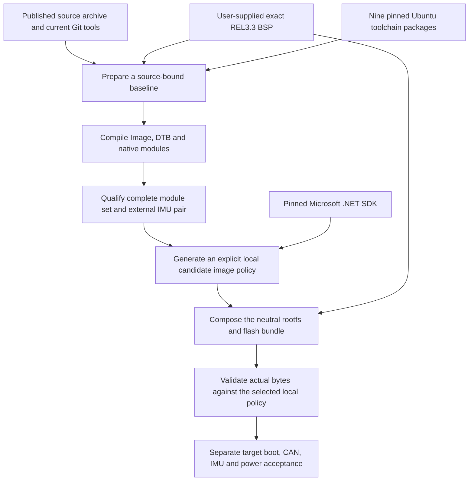

# Build a neutral image from published Linux sources and a supplied BSP

The public route takes the published preferred Linux sources, the current Git
checkout's tools, nine pinned Ubuntu toolchain packages, the pinned Microsoft SDK
and an exact TCH REL3.3 BSP supplied by the user. It prepares a baseline, compiles
and statically qualifies a new kernel, records an explicit local image policy and
composes a neutral image. It does not require an OMAM application checkout or a
previous private build receipt.

This is a source-build route with supplied board inputs. The project does not
bootstrap the entire Yocto distribution, bootloader and recovery firmware from
source, and the Git checkout does not contain those vendor binaries. Obtaining
BSP bytes for your own installation and redistributing a complete image are
separate matters. The applicable GPL source obligations and separate blob terms
are described in [licensing-and-sources.md](licensing-and-sources.md).



## Inputs, suppliers and boundaries

| Input | What is available | Required action |
|---|---|---|
| Current public Git checkout | Build, preparation, qualification and image tools; component patches; profile locks; tests and instructions. | Use the current default-branch checkout and keep its code/profile files unchanged during one build. |
| Published source release | Exact preferred Linux tree, board additions, applied vendor/CAN/charger changes, upstream IMU C/headers, configuration, per-file manifest and original notices. | Download the asset named in `source-release.json`, verify size/SHA256 and extract it. Its `extensions/` directory is a historical support snapshot; run current tools from the Git checkout. |
| Native ARM64 toolchain | Nine official Ubuntu HTTPS package URLs, exact sizes/SHA256 and compiler identity in `build-toolchain.json`. | Download and verify the packages, then extract them into a new local prefix. Host libraries and normal build prerequisites must be compatible. |
| .NET SDK | Official Microsoft URL and SHA512 in `dotnet-sdk.lock.json`; public staging tool. | Stage the exact Linux ARM64 SDK. The profile currently pins the .NET 11 GA SDK `11.0.100`. |
| TCH REL3.3 BSP | Nine exact file identities in `vendor-files.lock.json`; the binaries themselves are supplied separately. | Obtain the matching delivery through your iWave/support channel and retain its `Firmware/`, `Linux/` and UUU recipe layout. No public BSP download is promised here. |
| Five factory external modules | Their exact hashes and public GPL source candidates are recorded. Preparation extracts the five binaries from the supplied stock rootfs for local qualification. | Resolve effective corresponding-source completeness before binary distribution; candidate project URLs alone do not establish what the factory build used. |
| Whole-image publication | Source and redistribution inventory identifies remaining evidence and terms per component. | Resolve those release-specific items before publishing a complete firmware image. Local preparation or compilation is not redistribution clearance. |

The five preserved modules are `cryptodev.ko`, `igb_uio.ko`, `kpage_ncache.ko`,
`mlan.ko` and `moal.ko`. Preparation records the names of the 807 native stock
modules without retaining another copy of all 807 binaries. Qualification builds
those native modules again and adds the two upstream IMU modules for a total of
814. The stock rootfs library used by factory battery protection remains a vendor
input; its distribution terms are assessed independently of GPL kernel changes.

## Host and storage preparation

The exercised host is native ARM64 Ubuntu 26.04 LTS. Use a native ARM64 Linux
host with a compatible Ubuntu userspace, Python 3.12+,
Git, zstd, GNU tar/timeout, dpkg-deb, make, binutils, a host C compiler, kmod/depmod,
patch and the normal Linux build headers/libraries. The pinned target compiler is
`aarch64-linux-gnu-gcc-14 (Ubuntu 14.3.0-14ubuntu1) 14.3.0`. A compatible host must
supply development support such as libc, OpenSSL, ELF, zlib and zstd headers.
Installing the pinned prefix is not a replacement for the host's dependency set.
The maintained build scripts require native ARM64 and an explicit cgroup v2 scope,
CPU affinity, no swap, bounded memory and lowered priority.

Plan disk placement before downloading or compiling. The following are input
measurements and tool admissions, not elapsed-time estimates or a guarantee for
another filesystem:

| Material or stage | Size or admission |
|---|---|
| Published source archive | 230,766,173 bytes compressed; its complete regular-file payload is 1,531,588,302 bytes. Small-file allocation and directories require additional space. |
| Nine toolchain packages | 35,609,694 bytes downloaded; the retained extracted prefix has 115,518,770 logical regular-file bytes. |
| Stock rootfs | 1,322,170,532 bytes compressed, in addition to boot/recovery inputs supplied by the BSP. |
| SDK payload | The retained staged SDK has 576,381,329 logical payload bytes; staging also needs its compressed download and temporary extraction. |
| Baseline preparation | Tool admission: 32 MiB plus the 500 MiB reserve. It extracts configuration and five modules, not a second rootfs. |
| Native full build | Tool admission: 3 GiB work/output allowance plus the 500 MiB reserve. |
| Static qualification | Requires another 600 MiB free plus the reserve while build outputs remain available. |
| Neutral composition | Run `build_base.py --dry-run` for the current exact bound. The previously accepted inputs admitted 3,389,183,935 output bytes plus 97,426,019 scratch bytes and the reserve; a rebuilt candidate is checked again from its actual sizes. |

These requirements can overlap. A filesystem with only 3.5 GiB initially free
cannot also hold every downloaded input, unpacked tree, work directory and composed
image. Separate large input, work and output filesystems if necessary. Every stage
must preserve at least 500 MiB beyond its admitted outputs. Keep one accepted
candidate, the required inputs and rollback material; remove only owned temporary
or superseded outputs after their replacement has been accepted.

## Acquire the source and toolchain

Clone the current repository if needed, then run subsequent commands from its root:

```sh
git clone https://github.com/marcinborecki/OMAM_iwave-linux-extensions.git
cd OMAM_iwave-linux-extensions
mkdir -p .local/downloads
```

The following standard-library block fetches only the source asset and the nine
pinned packages. It verifies both size and SHA256 before publishing each local
file, and reuses an existing cache entry only after verification. It requires
room for downloads, a 2 GiB source-extraction allowance, a 256 MiB toolchain
allowance and the 500 MiB reserve on this input filesystem. Recheck actual free
space before later stages.

```sh
python3 -B - <<'PY'
import hashlib, json, os, shutil, signal, tempfile, urllib.request
from pathlib import Path
profile = Path('profiles/tch-g62h-imx91-rel3.3')
release = json.loads((profile / 'source-release.json').read_text())
toolchain = json.loads((profile / 'build-toolchain.json').read_text())
items = [dict(release['archive'])]
items += [{**item, 'name': item['deb']} for item in toolchain['packages']]
cache = Path('.local/downloads')
def interrupted(*_):
    raise KeyboardInterrupt
signal.signal(signal.SIGTERM, interrupted)
required = sum(item['bytes'] for item in items) + 2 * 1024**3 + 256 * 1024**2 + 500 * 1024**2
if shutil.disk_usage(cache).free < required:
    raise SystemExit('Insufficient free space for downloads, extraction allowances and reserve')
for item in items:
    target = cache / item['name']
    if target.exists():
        with target.open('rb') as stream:
            actual = hashlib.file_digest(stream, 'sha256').hexdigest()
        if target.stat().st_size != item['bytes'] or actual != item['sha256']:
            raise SystemExit('Existing cache entry differs: ' + target.name)
        continue
    temporary = None
    try:
        with tempfile.NamedTemporaryFile(dir=cache, prefix='.download-', delete=False) as stream:
            temporary = Path(stream.name)
            digest, total = hashlib.sha256(), 0
            with urllib.request.urlopen(item['url'], timeout=60) as response:
                while chunk := response.read(1024 * 1024):
                    total += len(chunk)
                    if total > item['bytes']:
                        raise ValueError('Download exceeds pinned size')
                    digest.update(chunk)
                    stream.write(chunk)
        if total != item['bytes'] or digest.hexdigest() != item['sha256']:
            raise ValueError('Download differs from its size/SHA256 pin')
        os.link(temporary, target)
    finally:
        if temporary is not None:
            temporary.unlink(missing_ok=True)
PY
```

Extract into new destinations. This block uses temporary directories on the same
filesystem and publishes each directory only after successful extraction. The
owned child process group and temporary directory are cleaned on interruption or
failure. It does not install the packages globally.

```sh
python3 -B - <<'PY'
import json, os, signal, subprocess, tempfile
from pathlib import Path
profile = Path('profiles/tch-g62h-imx91-rel3.3')
release = json.loads((profile / 'source-release.json').read_text())
packages = json.loads((profile / 'build-toolchain.json').read_text())['packages']
cache = Path('.local/downloads').resolve()
def interrupted(*_):
    raise KeyboardInterrupt
signal.signal(signal.SIGTERM, interrupted)
def run(command, deadline):
    child = subprocess.Popen(command, start_new_session=True)
    try:
        if child.wait(timeout=deadline):
            raise ValueError('Extraction command failed')
    finally:
        if child.poll() is None:
            os.killpg(child.pid, signal.SIGTERM)
            try:
                child.wait(timeout=5)
            except subprocess.TimeoutExpired:
                os.killpg(child.pid, signal.SIGKILL)
                child.wait(timeout=5)
for destination, kind in ((Path('.local/source-release'), 'source'), (Path('.local/toolchain'), 'toolchain')):
    if destination.exists() or destination.is_symlink():
        raise SystemExit('Use an absent extraction destination: ' + str(destination))
    with tempfile.TemporaryDirectory(prefix='.extract-', dir=destination.parent) as temporary:
        stage = Path(temporary) / 'payload'
        stage.mkdir()
        if kind == 'source':
            run(['tar', '--zstd', '--no-same-owner', '--same-permissions', '-xf',
                 str(cache / release['archive']['name']), '-C', str(stage)], 300)
        else:
            for item in packages:
                run(['dpkg-deb', '-x', str(cache / item['deb']), str(stage)], 60)
        stage.rename(destination)
PY
```

Set paths explicitly. `vendor_root` must point at the separately supplied directory
that directly contains `Firmware/`, `Linux/` and
`iG-PRGTT-TelematicsConnectHub.uuu`.

```sh
project_root="$PWD"
source_root="$project_root/.local/source-release/iwave-linux-source/linux"
source_manifest="$project_root/.local/source-release/iwave-linux-source/source-manifest.json"
toolchain_root="$project_root/.local/toolchain"
baseline_root="$project_root/.local/rebuild-inputs"
vendor_root=/absolute/path/to/the/supplied/REL3.3/delivery
work_root=/absolute/path/to/new/kernel-work
kernel_root="$project_root/.local/rebuilt-kernel"
kernel_receipt="$project_root/.local/rebuilt-kernel-build.json"
release_name=6.12.34-iwave-rel33-rebuild1
```

The published source manifest is 18,432,045 bytes with SHA256
`11d819b4da74eff7ed8cd81517c739d20f08cf69c42b1364fab4e5608a920d9e`.
The current profile binds it. `--source-manifest` validates every Linux source
file's bytes, type, mode and link target, and rejects extra relevant files. It
works without Git metadata; a root `.git` directory is not read. The existing
legacy Git-based route remains available when that option is omitted.

## Prepare the board baseline

```sh
python3 -B tools/kernel/prepare.py \
  --vendor-root "$vendor_root" --toolchain "$toolchain_root" \
  --output "$baseline_root"
python3 -B tools/kernel/apply.py --source "$source_root" --with-energy --check
```

Preparation validates all nine vendor files and the pinned compiler, extracts the
stock Image's embedded configuration, records all 807 native module names, extracts
only the five exact external modules and records the fifteen public vendor patches.
It generates the acquisition/toolchain/baseline receipts required by the build.
The source archive is already patched, so use `--check` rather than reapplying
vendor or project changes. An output directory from an unrelated preparation is
not accepted as a replacement.

## Compile and qualify the complete kernel set

Choose CPUs actually reserved on your host. The `1,2` example must be changed if
those CPUs are unavailable or belong to another workload. Keep the exact same
source manifest, prepared inputs, compiler, work directory and release throughout
compilation and qualification. `work_root` must be outside `source_root`.

```sh
build_cpus=1,2
systemd-run --user --scope --collect --unit=iwave-kernel-full \
  -p CPUQuota=150% -p AllowedCPUs="$build_cpus" \
  -p MemoryMax=6G -p MemorySwapMax=0 -p RuntimeMaxSec=11200 \
  taskset -c "$build_cpus" nice -n 10 python3 -B tools/kernel/build.py \
  --allowed-cpus "$build_cpus" --cpu-percent 150 --memory-gib 6 --jobs 2 --nice-min 10 \
  --source "$source_root" --source-manifest "$source_manifest" \
  --baseline "$baseline_root" --toolchain "$toolchain_root" --work "$work_root" \
  --output "$kernel_root" --receipt "$kernel_receipt" \
  --release "$release_name" --phase full

systemd-run --user --scope --collect --unit=iwave-kernel-qualify \
  -p CPUQuota=150% -p AllowedCPUs="$build_cpus" \
  -p MemoryMax=6G -p MemorySwapMax=0 -p RuntimeMaxSec=2400 \
  taskset -c "$build_cpus" nice -n 10 python3 -B tools/kernel/qualify.py \
  --allowed-cpus "$build_cpus" --cpu-percent 150 --memory-gib 6 --jobs 2 --nice-min 10 \
  --source "$source_root" --source-manifest "$source_manifest" \
  --baseline "$baseline_root" --toolchain "$toolchain_root" --work "$work_root" \
  --output "$kernel_root" --receipt "$kernel_receipt"
```

Do not create `kernel_root` before qualification. Build outputs live in the owned
work directory; the qualifier requires a new output directory. It installs the
native modules, preserves the five stock external binaries, builds the patched
upstream IMU pair, generates dependency indexes and checks symbols, namespaces,
loader/ABI layout, relocations, Image/config identity and DTB expectations. A
successful full compilation and a successful static qualification are distinct
results. Qualification failure is a failed candidate, not permission to drop a
module or weaken its checks.

## Stage the SDK, pin the candidate and compose

Create the SDK parent, then stage the public lock through the current tool:

```sh
mkdir -p .local/sdk
python3 -B tools/image/sdk_payload.py stage \
  --manifest profiles/tch-g62h-imx91-rel3.3/dotnet-sdk.lock.json \
  --cache-dir .local/downloads/dotnet \
  --output-dir .local/sdk/dotnet-11.0.100-linux-arm64
sdk_root="$project_root/.local/sdk/dotnet-11.0.100-linux-arm64"
local_policy="$project_root/.local/rebuilt-image-policy.json"

python3 -B tools/image/qualify_profile.py \
  --vendor-root "$vendor_root" --vendor-manifest "$baseline_root/inputs/manifest.json" \
  --kernel-root "$kernel_root" --kernel-receipt "$kernel_receipt" \
  --sdk "$sdk_root" --output "$local_policy"
```

A rebuilt kernel is a new candidate even when its source is unchanged. The
candidate policy records its actual qualified kernel/manifest hashes and exact
SDK. It leaves `profiles/tch-g62h-imx91-rel3.3/image-policy.json` unchanged. Only
pass a local policy produced and reviewed for your own build; do not automatically
trust a policy supplied beside an unverified image.

Use the explicit local policy for composition. Select suitable scratch/output
filesystems with the admitted free reserve. The example keeps output under the
project's ignored artifact directory; it can instead be a new absolute path on
another filesystem.

```sh
mkdir -p artifacts
image_root="$project_root/artifacts/my-rebuilt-neutral-base"
python3 -B tools/image/build_base.py \
  --profile tch-g62h-imx91-rel3.3 --image-policy "$local_policy" \
  --vendor-root "$vendor_root" --vendor-manifest "$baseline_root/inputs/manifest.json" \
  --kernel-root "$kernel_root" --kernel-receipt "$kernel_receipt" \
  --sdk "$sdk_root" --scratch-root /var/tmp --output "$image_root" --dry-run
```

If the dry run succeeds, rerun the identical command without `--dry-run` to compose.
The output includes nine boot/rootfs files and `base-manifest.json`. The rootfs is
neutral: accounts locked, no application or owner provisioning, explicit headless
boot/service dependencies and retained factory battery protection. Composition
performs its vendor-entry, SDK/kernel and neutral-content checks.

Finally validate the actual directory against your explicitly selected policy:

```sh
python3 -B - "$image_root" "$local_policy" <<'PY'
from pathlib import Path
import sys
sys.path.insert(0, str(Path('tools/image').resolve()))
from build_base import validate_base
validate_base(Path(sys.argv[1]), policy_path=Path(sys.argv[2]))
print('PASS: actual base content matches the explicitly selected candidate policy')
PY
```

Default validation without `policy_path` continues to select the maintained profile.
A custom-policy candidate is not silently relabelled as that maintained binary
release. A private application profile must explicitly trust the same local policy
when layering its own version, access, identity and application configuration.

## What each result establishes

`prepare.py` proves the declared BSP/compiler inputs and generates baseline
metadata. Full build proves that compilation succeeded. `qualify.py` proves the
exercised static kernel/module contracts. Candidate-policy generation pins those
new bytes; composition and validation check the actual image contents and software
boot connections. They do not execute a flash or claim physical boot, CAN traffic,
continuous IMU samples, measured power consumption or a verified wake route.

The full source-manifest build and 814-module static qualification passed on
ARM64 Ubuntu 26.04. The qualified core was packed, restored with the five exact
BSP modules without a compiler, and composed into a neutral image with the pinned
SDK. Downstream validation accepted its actual contents using an explicit local
policy. `profiles/tch-g62h-imx91-rel3.3/build-verification.json` records the source,
output hashes, test counts and physical NOT_RUN scope. The maintained default
image policy was preserved; a new rebuild still needs its own qualification.
