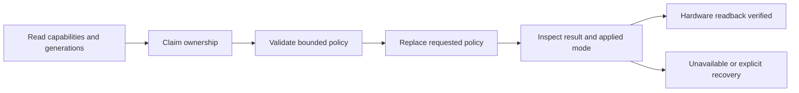

# Change catalogue and integration contracts

This catalogue distinguishes supplied BSP changes from extensions maintained here.
The source of each vendor row is the corresponding patch in the profile's ordered
`vendor-patches/series`. The final `kernel.config` records what was actually built;
a change to a vendor defconfig is not proof that every option appears in that final
configuration. Patch names are immutable provenance, including their older release
numbers and original spelling.

## REL3.3 is a board delivery, not a new driver collection

The last vendor patch, PATCH0014, changes the printed BSP version from REL3.2 to
REL3.3 in `drivers/soc/imx/soc-imx9.c`. PATCH0013 previously changed REL3.1 to
REL3.2. Neither patch adds a CAN driver, an energy manager, an IMU implementation
or a .NET runtime. Their place in the ordered series identifies the delivery.
The .NET 11 RC payload and the three project extensions are separate integration
inputs, with independent hashes and behavior checks.

The public profile therefore selects REL3.3 as a whole. It does not remove older
patches merely because their names contain REL2.x or REL3.2. Removing one can alter
the base hashes, board pin configuration or vendor driver behavior on which later
patches depend. A renamed patch list would hide the delivery history without
improving compatibility.

## Supplied vendor patches

| Order | Patch identifier | Observed changes | Integration consequence |
|---|---|---|---|
| 1 | PATCH000 | Updates the i.MX91 OSM Device Tree, carrier variants and broad platform defconfig; disables the upstream LSM6DSX option in that defconfig. | Establishes the vendor board baseline. The later upstream IMU pair needs an explicit external-module build. |
| 2 | PATCH001 | Adds the TCH G62H Device Tree and build entry, battery description and board peripheral wiring; enables built-in CAN, modem/USB and BQ256xx support. | A CPU module and its TCH carrier have distinct hardware descriptions. The TCH DTB is a pinned image input. |
| 3 | PATCH002, Acc_gyro | Adds the ST LSM6DSM vendor IIO driver, Kconfig/Makefile entries and sensor Device Tree changes. | The built-in vendor driver can create the sensor's interrupt mapping before a later upstream-driver handoff. |
| 4 | PATCH003 | Changes i.MX93 ADC calibration to retry after a failure, with diagnostic register output. | This is inherited vendor behavior, not a measured accuracy improvement. The supplied retry path has no explicit retry bound; host image acceptance does not qualify its behavior on a noisy board. |
| 5 | PATCH004, BLE_update | Adds a BLE wake GPIO key and changes BLE reset/BR pin settings. | Wake behavior depends on physical wiring and pin configuration, not only a userspace service. |
| 6 | PATCH005, BR_mode | Changes the BR-mode GPIO pad value from 0x518 to 0x318. | Preserve the exact board-specific pad setting; this is not a portable GPIO policy. |
| 7 | PATCH006, BLE_CTS_RTS_as_GPIO | Removes LPUART5 hardware-flow-control pin mux entries, exposes BLE RTS/CTS pins as GPIO and changes the vendor audit defconfig option. | A downstream serial setup must follow the final Device Tree and configuration. Hardware RTS/CTS cannot be assumed from connector labels. |
| 8 | PATCH007 | Deletes the obsolete `imx91-iwg50m-prgjj.dts` source. | A preferred-source package must preserve the deletion rather than silently restoring the file from the base Git commit. |
| 9 | PATCH008, A1_CPU_GPIOS_Modified | Changes assembly-configuration, cellular-status and charger GPIO pad values for the supplied revision. | Carrier and CPU revisions remain profile inputs. These changes do not establish compatibility with another revision. |
| 10 | PATCH009 | Updates the printed BSP identification to TCH REL3.0. | Identification only; do not infer new runtime capabilities from the banner. |
| 11 | PATCH0010, Battery_Current_Limit | Writes charger registers 0x02=0x85 and 0x03=0x11, adds readback output, and updates the banner to REL3.1. The vendor comment describes a 300 mA charging-current target. | This affects charging initialization, not application sleep policy. The supplied probe returns zero after these writes; later project readback/error reporting must not be confused with proof that every vendor initialization write succeeded. |
| 12 | PATCH0011, Battery_Shipment_Mode_Disable | Writes charger register 0x07=0x4c during probe and logs the result. | The project adds a separate, explicit shutdown-time opt-in. It retains this vendor initialization rather than making shipment mode unconditional. |
| 13 | PATCH0012, Quectel_USB_Serial_Driver_Code | Updates `option.c`, `qcserial.c` and `usb_wwan.c`. | Modem recognition/USB serial behavior is vendor source input. It does not configure an APN, SIM PIN or network subscription. |
| 14 | PATCH0013, REL3.2 | Updates only the printed BSP version to REL3.2. | Retained as part of the ordered vendor delivery. |
| 15 | PATCH0014, REL3.3 | Updates only the printed BSP version to REL3.3. | Selects the delivery identity; the Linux base remains 6.12.34. |

These observations explain what the supplied patches do. They do not assert the
vendor's undocumented motivation or certify every inherited driver path. Original
notices and licensing remain with the patch/source files.

## FlexCAN ownership, validation and observed state

The extension exposes Generic Netlink family `omam_flexcan`, ABI version 1. The
CAN data path remains SocketCAN. Its request is exactly 1128 bytes; its response
is 1168 bytes. Fields are little-endian, reserved/unused bytes are zero, and there
are at most 62 declared entries. The actual controller capacity reported at runtime
can impose a tighter constraint.

| Command number | Operation | Meaning to a client |
|---|---|---|
| 1 | GET_CAPS | Read controller capabilities and generation identity before choosing a policy. |
| 2 | GET_POLICY | Read desired policy and separately reported hardware state. |
| 3 | CLAIM | Request ownership under the controller/owner identity contract. |
| 4 | VALIDATE | Check a proposed mutation against syntax, generations and controller capacity. Validation is not successful hardware application. |
| 5 | REPLACE | Request replacement of the desired policy and inspect the application/readback result. |
| 6 | CLEAR | Request clearing under the same ownership/generation rules. |
| 7 | RELEASE | Relinquish ownership; clients must observe the resulting recovery state. |

Mutation and VALIDATE requests require a nonzero, strictly increasing request ID.
The SHA-256 payload digest covers the entire request with its digest field zeroed,
including generations, command and unused entries. Controller instance, owner epoch,
policy generation and capability generation prevent a stale client from treating a
new controller or another owner's state as its own.

Desired mode and applied mode have different roles. Desired policy may remain stored
while a controller is down, asleep, bus-off or otherwise unverified. Applied mode
`UNAVAILABLE` communicates that boundary. `READBACK` means the configuration was
verified when programmed; it does not promise that receive mailbox data words stay
constant while traffic arrives. A negative result is a failed operation.

The mask model distinguishes standard/extended identifiers and data/remote frames.
It cannot distinguish Classic data from FD data on the same identifier through the
RXIMR acceptance mask. Reserved Classic-only/FD-only requests must not become a
false positive capability. Replicas consume contiguous receive mailboxes in ascending
order. RX_BUSY faults and receive gaps are observable state, not reasons to pretend
a policy remained continuously effective.

## BQ25601 shutdown contract

The `ship_mode_on_poweroff` sysfs attribute is published only after checking the
supported model and actual silicon identity. An accepted arm/cancel write changes
RAM state only. It does not write BATFET registers immediately and does not persist
across a reboot. Arming during shutdown is refused.

During the I2C client's shutdown callback, the driver consumes and clears the arm
flag. It acts only for `SYSTEM_POWER_OFF`, rechecks silicon identity, then updates
REG07 bits 5 and 3 through a read/modify/write. Other bits are preserved. REG07 is
volatile in the regmap so stale cached defaults do not overwrite live state. A
bypassed read verifies the requested bits; an I2C failure or mismatched readback is
reported as an error.

The successful message explicitly leaves physical power-off unconfirmed. This is
delayed BATFET disable, not a programmable RTC wake mechanism. The application must
qualify a real wake route and the board supply behavior before it uses this path.
The native register model exercises all 256 original register-byte values to check
that unrelated bits survive; it cannot measure the board's supply current.

## IMU handoff contract

The external upstream core/I2C pair is built against the same kernel headers and
symbol versions as the image. The workaround applies only when the I2C client lacks
a usable IRQ, the parent/node can be resolved, and the expected two-cell specifier
can be interpreted with its first cell as hwirq. It reuses an existing mapping. It
does not create an alternative IRQ mapping or override its trigger type.

A driver handoff and a sensor sample are separate observations. Unbinding the
vendor owner, loading a compatible upstream pair and exposing IIO nodes still need
physical buffered-sample/interrupt validation for a hardware acceptance claim.
The neutral base ships the compatible modules but does not install an application's
private takeover policy.

## Neutral image changes

The image builder combines exact stock boot inputs with the qualified Image, DTB,
module set and .NET payload, then applies a small explicit neutralisation overlay.
It removes vendor account provisioning and network selections, locks password
accounts, empties machine identity, removes preexisting SSH host identity and
selects `multi-user.target`. Weston service/socket and the vendor modem-setup
service are masked because their removed home/network inputs would otherwise
leave a broken or misleading boot path. The vendor battery monitor and its runtime
are retained; their redistribution terms remain a separate publication gate.

A downstream application profile adds its own software and provisioning by overlay.
Independent comparison must prove that every retained base entry, including SDK,
kernel modules, indexes and boot inputs, still has its bound identity. This prevents
a private image recipe from quietly turning into a second platform implementation.

The latest-RC selection is frozen by the SDK lock and verification record, not by
a floating installer URL. On 2026-11-07 Microsoft's official .NET 11 channel metadata
identified SDK `11.0.100-rc.3.26522.148` and runtime `11.0.0-rc.3.26522.148`.
Changing that input later requires a new payload identity and appropriate renewed
image/consumer checks.
