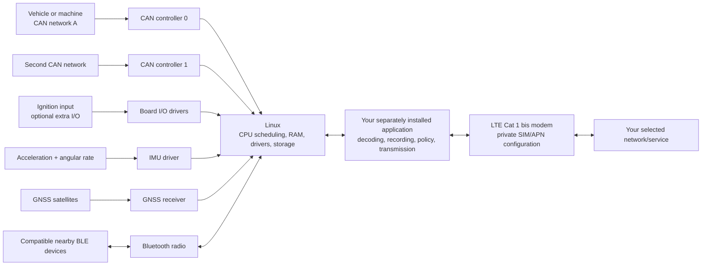

# Understanding the iWave Telematics Connect Hub G62H

This project supplies an operating-system platform for a particular iWave board.
Linux schedules the processor, manages memory, runs services and exposes hardware
through drivers even when no customer application is installed. The neutral image
also retains the factory battery-monitor path. A separate application decides which
data to collect, how to decode it, what power policy to request, and where to send it.
Vehicle decoders, cloud clients, customer programs and SIM profiles are supplied
and configured by the downstream application project.

## What the device is

iWave is the hardware manufacturer. Its Telematics Connect Hub, also called G62H or
TCH, is a compact Linux computer intended to sit between vehicle/asset signals and a
customer application. Think of a small enclosed computer connected through a wiring
harness, with its own radios and motion/location sensors. Its enclosure brings together processing, wired vehicle interfaces and local
location/motion sensing for an application installed by the integrator.

The public [iWave G62H specification](https://iwave-global.com/product/telematics-connect-hub/),
checked on 2026-11-07, lists this product-level inventory:

| Block | Published G62H provision |
| --- | --- |
| Compute/storage | NXP i.MX91, 1 GB RAM and 8 GB eMMC; larger memory/storage variants are advertised |
| Vehicle interfaces | Two CAN FD ports and an ignition input |
| Other wired I/O | Optional digital input, digital output and analog input; confirm the ordered assembly |
| Mobile connection | 4G LTE Cat 1 bis |
| Short-range radio | Bluetooth 5.2 |
| Location and movement | GNSS, accelerometer and gyroscope |
| SIM | Micro SIM; eSIM is an option, not guaranteed fitted hardware |
| Supply/enclosure | Advertised 9-32 V input, 800 mAh backup battery, 82 × 76 × 19.3 mm enclosure, IP67 product rating |

The processor's actual architecture is **one Arm Cortex-A55 core, up to 1.4 GHz**.
Use the [NXP i.MX91 specification](https://www.nxp.com/products/i.MX91) for the SoC
identity; a Cortex-A7 phrase in the iWave page's FAQ conflicts with that primary
processor specification. Choose exposed ports from the board and harness specification for the purchased
assembly. The processor specification describes internal capability; the product
specification identifies what the finished device makes available.

Memory/storage options, modem region, optional I/O and board revision must be checked
against the actual order and PCB. The development unit used for this project is not
evidence that every production assembly has identical wiring or fitted components.

## Picture the data paths

This is an original functional drawing, not a PCB layout or a pin-number diagram.
Optional I/O is conditional on the ordered hardware.

Drivers establish the operating-system mechanisms. The consumer selects sample rates,
calibrates its sensor installation, authorizes its vehicle operations and configures
network reachability. These are integration decisions with measured results.

## What each interface can tell an application

**CAN is a message bus.** Linux SocketCAN represents a CAN controller as a network
interface. A frame contains an identifier and a short byte payload; it does not arrive
with labels such as fuel level or battery state of charge. A vehicle-specific database,
protocol implementation or decoder is needed to give those bytes meaning. Connecting
two CAN ports does not make Linux automatically bridge them, and this project does
not configure a universal vehicle gateway.

Classical CAN carries up to **8 payload bytes** per frame. CAN FD extends that to
**64 bytes** and can use a separate data-phase bitrate. An FD-capable controller can
also be configured for Classical CAN; a vehicle using Classical CAN does not become
FD because the attached computer supports it. Wiring, termination, bitrates, controller
mode and every participating node must suit the actual bus. These distinctions and
the Linux interfaces are documented in the [kernel SocketCAN guide](https://docs.kernel.org/networking/can.html).
This overview does not provide a vehicle wiring prescription or a CAN-transmit example.

**GNSS concerns position and time; the IMU concerns motion.** Acceleration and angular
rate can support motion events, orientation estimates or a consumer's power-policy
inputs. The consumer combines those samples with GNSS or appropriately decoded vehicle
signals for its intended interpretation. Reception, mounting orientation, calibration
and the algorithm all matter. A safety-related interpretation requires its own
qualification.

**Bluetooth connects nearby compatible devices.** A consumer might implement a BLE
sensor gateway or a local configuration tool. The consumer supplies the sensor protocol, pairing policy and decoder that match
its selected accessories.

**LTE connects the application to a chosen network.** It needs the fitted modem's
regional compatibility, an appropriate SIM/subscription and the downstream APN/network
configuration. Bluetooth 5.2 serves nearby radio links; 4G LTE Cat 1 bis serves the mobile
operator connection. The downstream profile configures the actual network path.

**Optional I/O requires its own electrical specification.** A digital input, output or
analog channel is not automatically safe for an arbitrary vehicle wire or load. Obtain
the harness specification for your assembly before using it. Do not derive pin voltage,
polarity, current rating or output behavior from a product marketing table.

## Where it could be installed

Possible project scenarios include a protected bench setup with two CAN simulators,
a fleet logger with an approved harness behind an interior trim panel, or an asset
monitor in a machine's suitable electronics compartment. These are examples for
understanding the device, not factory-approved mounting locations or a vehicle-specific
installation procedure.

A real installation must resolve harness routing, strain relief, the enclosure's
specified mounting arrangement, antenna reception, supply behavior, environmental
conditions and the orientation used by the IMU consumer. The product's IP rating is
not a rating for an open development PCB, a disconnected connector or an improvised
harness. Obtain the correct mechanical drawing and harness specification from iWave
for the purchased revision before choosing a mounting location.

For a development session, keep the wiring roles separate: harness power feeds the
board, the special J4 cable serves flashing, and the revision-specific debug serial
accessory supplies UART logs. A USB connector's presence does not identify its role.
The [installation guide](../installation-tch-g62h.md) gives the verified connector
labels and explains what is still unknown about pin orientation and board revision.

## What this profile changes

| Component | Problem addressed | What remains a consumer or hardware check |
| --- | --- | --- |
| FlexCAN controller policy | Irrelevant bus traffic can consume controller mailboxes and interrupt/driver work before userspace filtering | A consumer selects complete bounded rules and verifies actual mode/readback; real traffic and fairness need board measurement |
| BQ25601 power-off hook | A halted CPU alone does not necessarily disconnect backup-battery load | A consumer explicitly opts in for graceful power-off only after establishing a valid wake/power arrangement |
| ST LSM6DSX existing-IRQ fallback | Vendor-driver handover can leave an existing IRQ mapping that a fresh mapping attempt refuses | A consumer must coordinate sensor ownership and verify interrupts, buffers, samples and calibration |
| .NET SDK/runtime payload | A downstream managed application needs a matching runtime/toolchain | The consumer installs its managed application separately |

The current board profile pins normal-boot Device Tree `imx91-iwg62h-prgtt.dtb`,
Linux `6.12.34-omam-rel33-policy1`, SDK `11.0.100-rc.3.26522.148` and matching
.NET/ASP.NET RC3 runtimes. Release/ABI names containing `omam` are retained compatibility
identifiers, not evidence of a customer agent or its configuration being installed.

The FlexCAN IP uses the `fsl,imx93-flexcan` compatible string on this i.MX91 board.
That identifies an IP block; it does not qualify an arbitrary i.MX93 carrier. Hardware
mailbox capacity is finite, and increasing an application queue cannot create filters.
Controller programming/readback and actual traffic behavior are separate evidence.

The charger mechanism is RAM-only explicit opt-in, not a general energy manager.
The factory battery monitor remains the neutral image's default software path.
Backup battery state, external power and the real wake route must be considered
together. Marketing current figures are not measurements of this custom image,
installation or a consumer's chosen sleep policy.

The vendor-built-in IMU driver and upstream `st_lsm6dsx` pair must not control the
same sensor simultaneously. The fallback only looks up the existing mapping under
its known node/domain/specifier assumptions. It does not create an IRQ mapping,
retype a trigger or justify force-loading an unrelated module.

## Access and future boards

Neutral image password accounts are locked. There is no published default login,
remembered network connection, selected APN or shared device identity. Reading boot
messages over the debug UART does not require a Linux login, but reaching an interactive
shell does. Prepare a controlled private access profile before installing an image
that you expect to administer. Linux and its existing services still run without
customer login or a customer application.

To add another iWave board, record its exact SoC, controller IP/transceivers, charger,
IMU/IRQ wiring, boot chain, storage, modem, harness and wake arrangement. Add a new
profile with exact source/config/patch pins and its own checks. Reusing a component
can be sensible; reusing this board's Image/DTB without qualification is not a support
claim. The same rule applies to a later project for another manufacturer.
