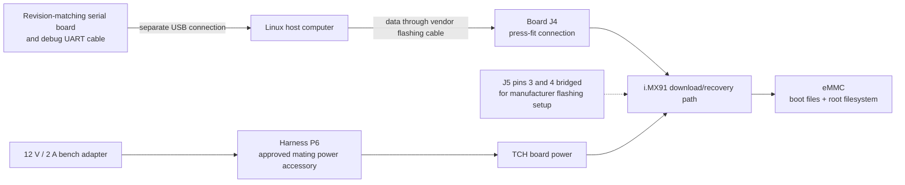
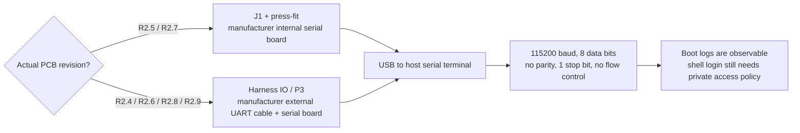

# Installing a TCH G62H i.MX91 image

This repository supplies the Linux platform and hardware extensions on which an
integrator installs and configures a customer telematics application. Linux already manages CPU, RAM, storage, drivers
and services; the neutral image retains the factory battery-monitor path. A separate
consumer supplies application logic, selected data/decoders, high-level policy,
network destinations and private deployment configuration.

This guide explains the **G62H/TCH i.MX91** installation path supported by the retained
manufacturer documents. It is not a procedure for another iWave model. Commands below
are documented instructions, **NOT RUN against hardware during this documentation
work**. Host archive checks do not prove successful flashing, first boot or peripherals.

## 1. Understand what you have downloaded

A GitHub source ZIP or Git clone is **not a flashable image**. It contains extension
sources, exact profiles and tools. It excludes local BSP deliveries, acquired source
workspaces, SDK payloads, images and private configuration. Obtain the correctly
licensed board deliverables and build/receive an accepted image separately. Public
publication of source code is not permission to redistribute every vendor binary;
source-completeness and redistribution gaps are recorded separately.

There are three distinct artifacts:

| Artifact | Contents | Usable as a ready customer installation? |
| --- | --- | --- |
| This source repository | Linux changes, tests, recipes, profiles and documentation | No bootable kernel/rootfs is implied |
| Neutral Linux base | Board boot/recovery inputs, qualified Linux/modules and pinned .NET SDK; `base-manifest.json` binds them | Password accounts are locked; no customer application, APN, private key or usable default login is supplied |
| Downstream private image | The accepted base plus an explicitly prepared private access/application profile | Only after that consumer has checked access, configuration and hardware suitability |

The neutral image is deliberately not configured with a shared password or remembered
cellular connection. **Prepare your own private access profile before flashing if you
need a shell or remote administration.** A serial cable lets you observe boot output;
it does not bypass locked Linux login accounts. Do not discover after flashing that
your only planned access depended on an absent password or APN.

## 2. Identify the hardware and obtain the matching accessories

Record the actual board model, PCB revision and fitted modem. The phrase “development
version” does not identify a PCB revision or UART wiring. The public
[iWave product page](https://iwave-global.com/product/telematics-connect-hub/) is a
product overview; obtain the revision-matching Hardware User Manual and harness
specification from iWave for physical pin orientation and electrical details.

The following functional drawing is original explanatory material. It does not show
pin order, connector orientation or the physical positions of J4/J5 on a PCB.



Have the matching TCH board/enclosure and harness, the supplied or correctly matched
12 V / 2 A supply/accessory, vendor J4 flashing cable and press-fit, the J5 jumper,
and the correct debug serial accessory for the actual PCB. Use a host USB data path
that can enumerate the device, not a charging-only cable. The manufacturer accessory
list distinguishes the **flashing cable** from an ordinary **USB OTG cable**.

Manufacturer HW manual s.6 requires power to be disconnected when connecting or
removing hardware and ESD-appropriate handling. Its s.9 also requires disconnecting
the backup battery before completely removing the PCB from the enclosure. External
12 V removal alone does not prove the backup-powered electronics are off. Do not
manipulate jumpers or press-fit headers on an energized board.

### Power connection: P6 and the P2 alternative

The documented bench arrangement is **12 V, 2 A through harness P6**, with the
matching power connector accessory (HW s.11, §2.5, fig.7). Do not infer DC polarity,
plug dimensions or individual harness pin numbers from that statement.

The manual gives a manufacturer-supplied **P2/OBD power-board alternative** when P6
has problems, and a suitable mating DC-plug option for P6 (HW s.11-12, §2.5.1,
fig.8-9). **Do not feed P6 while using the power board at P2.** The figure explicitly
makes those arrangements exclusive. It does not authorize feeding arbitrary OBD
pins or adapting a generic cable without its electrical specification.

The product family's wider published input-voltage range is not a replacement for
this documented bench supply and matching harness arrangement.

## 3. Validate the neutral base and prepare private access

The profile is `tch-g62h-imx91-rel3.3`. The normal-boot DTB is
`imx91-iwg62h-prgtt.dtb`; similarly named recovery DTBs serve a different boot stage.
The current pinned set uses kernel `6.12.34-omam-rel33-policy1` and .NET SDK
`11.0.100-rc.3.26522.148`. Read exact identities from the actual base manifest and
profile rather than inferring compatibility from a filename or a generic “REL3.3” label.

From the repository root, the existing public validator can check a supplied neutral
base directory without contacting hardware:

For a separately rebuilt candidate, supply the explicitly trusted local policy
created by `tools/image/qualify_profile.py` as `policy_path=Path(...)` to
`validate_base`. The default call below selects the maintained release profile;
it does not automatically trust a policy supplied by an image itself.

```sh
PYTHONPATH=tools/image python3 - /absolute/path/to/neutral-base <<'PY'
from pathlib import Path
import sys
from build_base import validate_base

base = validate_base(Path(sys.argv[1]))
print("Accepted neutral base profile:", base["profile"])
PY
```

Replace the example path with the received or built directory. The check verifies
the profile, file hashes, qualified source/kernel identities, actual SDK/modules and
scoped neutral archive content. It requires its ordinary host dependencies, including
`zstd`. Failure is not permission to skip a hash, relabel an artifact or substitute a
stock rootfs. Passing does not make locked accounts remotely accessible.

A downstream access profile is private input: for example, its own account policy,
public SSH authorized-key material for that installation, required SSH configuration
and network configuration. Private keys stay with their owner. The exact files and
service policy depend on the consumer and must be reviewed/tested there. No generic
SSH installer or complete access-profile generator is supplied here.

The existing reusable APIs for a downstream integrator are:

```python
base = validate_base(neutral_base_directory)
composition = compose_overlay(
    neutral_base_directory / "Linux/rootfs.tar.zst",
    base["files"]["Linux/rootfs.tar.zst"]["sha256"],
    private_rootfs_output,
    private_overlay_directory,
    private_overlay_plan,
    source_date_epoch=selected_epoch,
    preserve_overlay_ownership=True,
)
verification = verify_overlay(
    neutral_base_directory / "Linux/rootfs.tar.zst",
    private_rootfs_output,
    private_overlay_directory,
    private_overlay_plan,
    preserve_overlay_ownership=True,
)
```

This is an API integration example, not a newly tested installer command. `validate_base`
comes from `tools/image/build_base.py`, `compose_overlay` from `compose_rootfs.py`,
and `verify_overlay` from `verify_composed_rootfs.py`. The integrator supplies each
explicit Path input and a plan object file using `schema_version: 1`, exact `delete`
and `replace` path lists. It also owns account permissions, service enablement and
acceptance of the resulting access. SDK injection is not repeated by this path.

A complete downstream bundle must bind its modified rootfs with its own checked
manifest/checksums and preserve the accepted boot/kernel/SDK content. Do not carry a
neutral-content PASS forward as if it described an image after adding private access
or application settings. Keep the original neutral base and private output identities
distinct. This repository does not promise that an arbitrary overlay preserves a
supported installation or invent a replacement vendor boot script.

## 4. Check the complete flash input directory

The retained UUU script uses relative paths. Run it from the directory containing the
script and the following nine inputs, with original case and filenames:

```text
private-flash-bundle/
├── iG-PRGTT-TelematicsConnectHub.uuu
├── Firmware/
│   ├── Image_uuu
│   ├── flash_uuu.bin
│   ├── imx91-iwg50m-prgjj_uuu.dtb
│   └── initramfs.cpio.zst.u-boot
└── Linux/
    ├── Image
    ├── flash.bin
    ├── imx91-iwg62h-prgtt.dtb
    └── rootfs.tar.zst
```

Metadata is additional to these nine inputs. The `Firmware/` files are for the
recovery/flashing environment; the `Linux/` files become the installed system.
Neither a source ZIP nor an Image file alone is enough. The `iwg50m` recovery name
must not be renamed to match the `iwg62h` normal-boot DTB.

Use an appropriate host build of NXP's [Universal Update Utility](https://github.com/nxp-imx/mfgtools)
and its documented installation instructions. A device ARM64 binary is not an x86-64
host utility. The script's `uuu_version 1.4.43` declaration is not a statement of the
actual host binary's version. Keep the host binary separately identifiable and verify
its provenance for the selected release.

Before touching hardware, check every file against the downstream bundle's actual
manifest. If that reviewed bundle supplies `SHA256SUMS`, the corresponding command is:

```sh
cd /absolute/path/to/private-flash-bundle
sha256sum -c SHA256SUMS
```

A neutral builder's `base-manifest.json` is not automatically a `SHA256SUMS` file, and
recomputing checksums of unknown files does not establish trusted input identity.

## 5. Enter the documented flashing setup

Full UUU installation is **destructive**. The retained script writes the bootloader,
wipes filesystem signatures, replaces the eMMC partition table, formats the FAT and
ext4 partitions, then writes kernel/DTB/rootfs. It does not preserve installed
application state, captures, configuration or identity. Plan any required export or
migration in the consumer before this operation.

With power disconnected and the actual matching hardware identified:

1. Locate **J5** from the matching manufacturer's PCB figure. Bridge **pins 3 and 4**
   as documented in HW s.12-13. No physical pin orientation or alternate DIP setting
   is implied by this text or its functional drawing.
2. Attach the vendor flashing cable to **J4** through its matching press-fit.
3. Attach its host end to the Linux computer. If using a VM, assign the USB device
   to that guest, including any re-enumeration during recovery; host detection alone
   is not guest access.
4. Apply the documented harness power arrangement. Do not power P2 and P6 together.
5. From the checked bundle directory, run the manufacturer's script with the selected
   compatible **host** UUU executable:

   ```sh
   sudo /absolute/path/to/uuu ./iG-PRGTT-TelematicsConnectHub.uuu
   ```

The Linux command follows HW s.13. It is documented here, not executed by this task.
An open UUU process or its initial wait message is not success. The manufacturer's
completion example requires **Success 1, Failure 0**. Preserve a failure's actual
output and diagnose the target, cable, power and guest USB ownership before retrying.
Do not treat a partially written eMMC as a successful installation.

After successful completion, disconnect power, remove the **J5.3/J5.4** jumper, and
restore normal power for eMMC boot. The manual explicitly requires jumper removal;
power-off/removal/restart is the operational sequence used here to apply that rule
without moving the jumper on powered hardware. It is not an additional undocumented
DIP-switch recipe.

## 6. Observe boot through the correct UART accessory

Debug serial is separate from J4 flashing. The Hardware User Manual makes this
revision distinction (s.15-16, §2.7, fig.16-17):

| Actual PCB revision | Documented debug arrangement |
| --- | --- |
| R2.5, R2.7 | Internal **J1** through press-fit and the manufacturer's Serial Debug Board. The manual says not to use the external setup for these revisions. |
| R2.4, R2.6, R2.8, R2.9 | External Debug UART cable at the harness **IO/P3** connection, then the matching serial board and USB to the host. |
| Unknown or another revision | Obtain the matching iWave instructions; do not guess a route from this table. |



The settings are **115200, 8N1, no hardware or software flow control** (HW s.17).
Select the actual newly enumerated host serial port. A Linux terminal example is:

```sh
sudo minicom -D /dev/ttyUSB0 -b 115200
```

`/dev/ttyUSB0` is an example, not a guaranteed name; another USB serial device can
already own that number. Configure 8 data bits, no parity, one stop bit and both flow
controls off in the terminal. Start observing before normal power-on to retain the
early boot log. The manufacturer also describes Tera Term for Windows, but this
guide's image/tooling examples use a Linux host.

Fig.16 labels **VCC_3V3** and **GND** on the internal serial accessory. It does not give
a complete numbered TX/RX pinout or establish external P3 signal voltage. Do not
substitute an arbitrary USB-TTL/RS232 adapter, infer wire polarity or connect a power
lead from that single label. Use the matching accessory and revision-specific pinout.

Boot logs can establish that a boot stage ran or report its error. A login prompt is
not proof of valid login credentials. A running kernel is not proof that the modem
connected, a CAN bus is correctly wired, IMU interrupts are delivering samples or a
power-off mode can wake. Verify those separately under the consumer's actual profile.
The current extension set's retained physical acceptance remains distinct from its
host/build/static evidence.

## 7. When installation does not complete

The manuals do not supply a detailed interrupted-flash recovery matrix. A reasonable
operational recovery is to keep the exact checked input set, resolve the observed
host/cable/power issue, return the same board to the documented J5/J4 recovery setup
and repeat UUU. This is an operational inference, not a manufacturer guarantee of
state preservation or a new recovery firmware procedure. If the ROM/recovery device
cannot be reached or the revision/accessory is uncertain, use iWave's support route.

If flashing completes but normal boot does not, first distinguish a remaining flashing
jumper, missing boot media/files, early boot errors and a locked login. Capture the
actual serial output through the correct accessory. Do not weaken image pins, modify
bootloader commands blindly or assume that missing private access means Linux failed.

## Manufacturer evidence and unresolved details

These references identify the privately supplied documents inspected for this guide.
They are **not included in this public repository**. Obtain authorized copies from
iWave. Descriptions and functional diagrams above are newly written; no vendor PDF
pages, PCB photographs or proprietary figures are reproduced.

| Evidence | Exact identity and relevant pages |
| --- | --- |
| `iG-PRGTT-UM-R2.0-REL1.7_Telematics_Connect_Hub_HardwareUserManual.pdf` | Rev2.0/REL1.7, 24-Apr-2026, 24 pages. SHA-256 `4633153946b0cfd9ed198e6091dc62dd07c4662a2d2884e90c4eb6c09217d08a`. Safety/power handling s.6 and 9; accessories s.7; harness power s.11-12; flashing s.12-14; revision-dependent UART s.15-17. |
| `iG-PRGTT-UM-R2.0-REL3.2_Telematics_Connect_Hub_Software_User_Manual.pdf` | REL3.2, 20-Aug-2026, 19 pages. SHA-256 `32a072c37e0338c2a5e823a1fb744fd9c604226c563f4671f2089c42f21d54a2`. Section 3.3 on s.11 delegates flashing/debug hardware procedure to the Hardware User Manual; its document revision does not select BSP REL3.2. |
| Retained `iG-PRGTT-TelematicsConnectHub.uuu` | 2617 bytes; SHA-256 `96f6135a66d70777f9b8859a35fc427bd80fdc1f21d8eb586a20e94d70b50d38`. Relative nine-file input layout, recovery boot and destructive eMMC formatting/writes inspected directly. |

Printed page numbers and PDF page numbers agree in the inspected manuals. Complete
numbered pinouts for P6/P3/J4/J1, DC polarity, a universal DIP/boot-mode table and the
exact revision of an arbitrary reader's development board were **not established**
by this evidence. Those details must come from that assembly's harness/board documents,
not from an inferred connector photograph or another iWave product.
