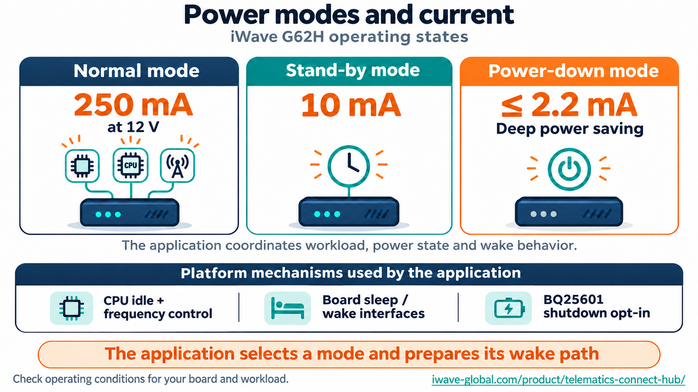
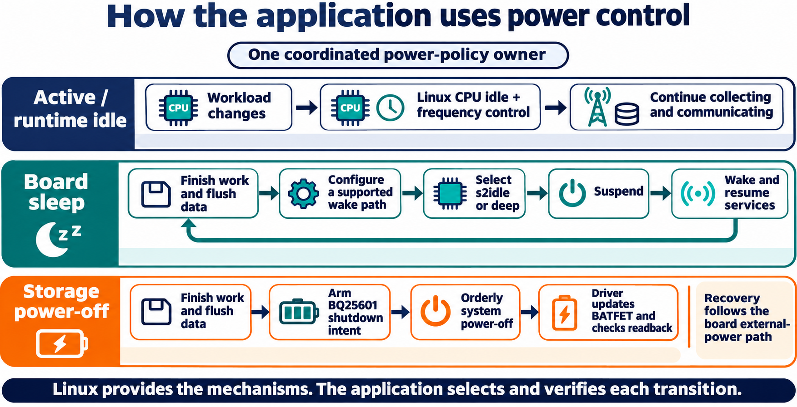

# Power management: mechanisms, policy and current

The Linux platform supplies ways to reduce work, suspend the board and request an
orderly storage power-off. The application coordinates those mechanisms with its
capture/transmission workload and a verified way to return. The neutral base keeps
the factory battery monitor as the initial protection owner.



## Current figures and what they describe

The G62H product specification table gives normal operation at **250 mA / 12 V**,
stand-by at **10 mA**, and power-down at **≤2.2 mA**. These are reference figures
from [iWave's current G62H product page](https://iwave-global.com/product/telematics-connect-hub/).
They describe operating states whose result depends on supply, charging, modem,
sensors, buses, wake setup and application work.

The same page's FAQ gives approximately **1.2 mA** for deep power-down. The table
and FAQ therefore need their mode definitions and measurement conditions reconciled
before sizing a deployment's power budget. This guide uses the table's values as
reference points and records measured results separately.

The device-supply current, the charger's battery-current setting and CPU workload
are different quantities. Keep the measurement point and charging state with each
result when comparing the operating-mode table to a real installation.

## Program-controlled paths

The platform and existing downstream integration provide the following mechanisms:

| Intent | Mechanism | What remains operational / return contract |
|---|---|---|
| Active | Linux scheduler, drivers and normal services. | Workload uses the selected sensors, buses and network. |
| Runtime idle | CPU idle/frequency control plus reduced application activity. | Linux and the selected communications can continue running. |
| Board suspend | A supported `s2idle` or `deep` selection through Linux PM and the board's wake interfaces. | A configured wake route resumes the system and application. |
| Storage power-off | `ship_mode_on_poweroff` followed by orderly system power-off on the supported BQ25601. | The charger performs delayed BATFET control; the installation plans its external-power recovery path. |

The qualified kernel enables `CONFIG_PM`, `CONFIG_PM_SLEEP`, `CONFIG_SUSPEND`, CPU
idle and CPU-frequency support. Its default CPU-frequency governor is ondemand.
The running board advertises its actual supported suspend states. A downstream
manager discovers those states and validates its selected wake/backend combination
before requesting a transition.

The existing downstream application already implements active/runtime-idle,
`s2idle`, `deep` and storage-shipment paths with orderly quiescence. The platform
provides their low-level mechanisms; an application manager owns operational policy.
A measured current is recorded for the chosen combination rather than treated as
a configurable numeric target such as “set current to 2.2 mA”.



## Board sleep: prepare, suspend and resume

A coordinated application manager follows this sequence:

1. Select a supported state and wake combination for the actual board/modem.
2. Stop producers and finish durable writes and pending protocol/actuator work.
3. Configure wake sources and check their reported state before entering sleep.
4. Select the supported Linux PM backend and enter suspend through the platform.
5. Observe the wake event, confirm resume and restore the required services.

RTC/timer, ignition, CAN, motion and modem wake are distinct routes with their own
hardware and software conditions. The vendor API manual describes configuration
interfaces for them. Each selected mode gets its own evidence; an interrupt source
being configurable does not establish that it remains powered through every state.

The vendor BLE path has its own documented sequence: configure its intended wake,
request BLE sleep, allow the specified two-second handoff, then request host sleep
for that selected path. An application uses one coordinated route rather than
mixing independent callers that compete for the same peripheral and power owner.

The software manual also describes placing CAN into standby before sleep when CAN
is not the selected wake source. Choosing CAN wake therefore includes reviewing
transceiver state and the actual bus-to-wake path. The library manual's SMS example
is specifically scoped to an EG95-EX modem; modem capabilities are checked for the
selected installation.

## Storage: explicit shutdown intent

The BQ25601 patch adds a one-shot RAM flag named `ship_mode_on_poweroff`. Its
read/write handler verifies model and actual silicon identity before arming.
Arming is an intent for a later orderly shutdown. Cancelling that intent restores
the disarmed state without a BATFET write.

At the system power-off callback the driver consumes the flag, verifies the part,
updates REG07 bits 5 and 3 through a volatile read/modify/write and checks the
result with an uncached read. Other register bits are preserved. This makes the
requested low-level transition observable and keeps it at the final shutdown
boundary, after applications and filesystems have finished their work.

An application must coordinate the final power-off, its data flush and the planned
recovery path. The storage profile's return is external-power recovery; a board
sleep profile instead arranges a wake/resume cycle. These are different electrical
states and different operational choices.

The patch is already integrated into the qualified public kernel. Its initial
RAM flag is disarmed so that the application can arm it for one chosen transition.
A storage request then uses that existing mechanism. A boot-time unconditional
shutdown policy would conflict with ordinary active use of the same neutral base.

## Read the available platform state

After logging into a provisioned device, these commands inspect its advertised
interfaces without requesting a power transition:

```sh
cat /sys/power/state
cat /sys/power/mem_sleep
cat /sys/devices/system/cpu/cpu0/cpufreq/scaling_available_governors
cat /sys/devices/system/cpu/cpu0/cpufreq/scaling_governor
```

A platform may expose a subset or a differently arranged CPU-frequency interface.
Read the actual filesystem/driver state and use the selected manager's checked
transition path. The documentation commands were source-reviewed; this update
performed no device sleep, shutdown or wake operation.

## Measure the selected installation

For each intended state, record the board revision, image identity, application
policy, supply voltage, external/battery supply state, charging state, modem/SIM,
GNSS/Bluetooth/CAN activity and selected wake source. Measure after stabilization,
then verify return and service/data continuity. This connects a mode name and its
software request to the electrical result a deployment needs.

Existing qualification for the current local base covers code, ABI and archive
content. The current record leaves physical current/wake acceptance for the actual
board run. The previously owner-deferred physical acceptance has not been restarted
by this documentation change. A discovered software defect in that run becomes a
specific correction to the existing mechanism or consumer.

## Source traceability

- iWave G62H product page, Power Characteristics table and low-power FAQ, checked
  2026-11-07: [manufacturer specification](https://iwave-global.com/product/telematics-connect-hub/).
- iWave Library API Reference Manual R2.0/REL3.1, SHA-256
  `0dd81cb8e8f87562ca355bccea035c65f6f2ce595b099c0143382d33dac7cef6`:
  timer/sleep pages17-18, ignition18-19, modem25, CAN33, motion43-44, BLE/RTC50-51.
- iWave Software User Manual R2.0/REL3.2, SHA-256
  `32a072c37e0338c2a5e823a1fb744fd9c604226c563f4671f2089c42f21d54a2`:
  battery/CAN protection page14 and storage discussion page18.
- Qualified `profiles/tch-g62h-imx91-rel3.3/kernel.config` and the source patch in
  `components/bq25601-poweroff/` identify the mechanisms included in this profile.

The diagrams and prose are original explanatory material. Vendor manual text,
photographs and figures remain in their original distribution.
